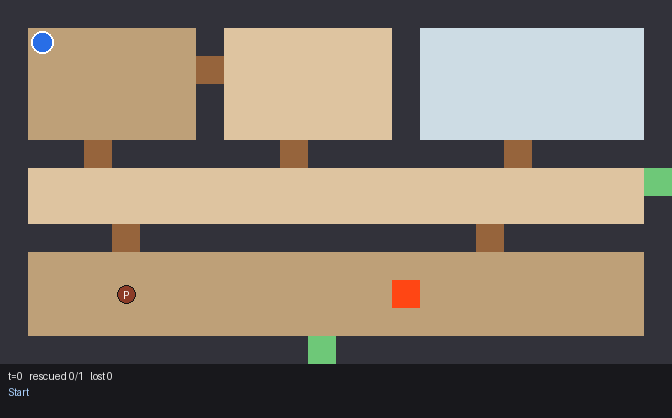

# emberpath

**A rescue agent that notices when the rules of its world have changed, and adapts.**

A house is on fire. The agent has to get a dependent out (a dog, a spouse, or two children). Then
the world changes without warning: a door jams, or the carpet starts burning much faster than
anyone expected. A normal planner keeps trusting its old rulebook and fails. This agent is built
to notice the mismatch, work out *what* changed, rewrite that one rule, and replan, and then say
why in plain English.

| Rulebook goes stale (baseline) | Same world, correct rulebook (oracle) |
|---|---|
|  |  |
| Keeps walking into a door that no longer opens. Times out. | Knows the door is jammed and takes the other route. Success. |

The project's goal is to build the agent that gets from the left column to the right column
*without being told what changed*.

## The one number that matters

```
gap_closed = (adaptive - baseline) / (oracle - baseline)
```

`baseline` plans with textbook rules and never updates them. `oracle` cheats and always knows the
true rules, so it is the best this planner can do. `adaptive` is the agent we are building. If it
scores like the baseline, it learned nothing; like the oracle, it learned everything.

Current benchmark (ranch house, 60 seeds, mean score; regenerate with `make results`):

| household | novelty | baseline | oracle | adaptive |
|---|---|---|---|---|
| single (dog) | none | 0.85 | 0.85 | *not built yet* |
| single (dog) | door jams | 0.03 | 0.82 | *not built yet* |
| kids (two) | door jams | 0.17 | 0.75 | *not built yet* |
| kids (two) | carpet burns faster | 0.65 | 0.84 | *not built yet* |

Full table: [docs/results.md](docs/results.md). Note the control row: with no novelty, baseline and oracle
are identical, so any gap elsewhere is caused by the world changing, not by noise.

## Quickstart

```bash
pip install -e ".[dev]"
make test                                   # 49 tests pass; 7 acceptance tests xfail (features not built yet)
make audit                                  # try to hack the reward with degenerate policies
emberpath list                              # households, novelties, blueprints
emberpath show --blueprint ranch            # the floor plan
emberpath run --profile single --novelty door_jam --agent baseline --gif out.gif
emberpath run --profile single --novelty door_jam --agent oracle   --gif out.gif
emberpath eval --profile kids --novelty carpet_flashover --agents baseline oracle --seeds 30
```

Or in Docker: `docker build -t emberpath . && docker run --rm emberpath`.

## Build it out with Claude Code

This folder is set up to be extended by Claude Code. Open it there and run `/work-package A` to start on the first
unbuilt feature. See [START_HERE.md](START_HERE.md) for setup, [docs/SPEC.md](docs/SPEC.md) for every requirement with its status,
and [tasks/README.md](tasks/README.md) for the work packages, their dependencies, and a suggested order. `CLAUDE.md` holds the
rules Claude Code follows here.

## What exists today and what doesn't

| Phase | What | Status |
|---|---|---|
| 1 | World: blueprints, fire, smoke, dependents, rule-trial event log | done |
| 2 | Households: single / married / kids as parameterized profiles | done |
| 3 | Symbolic hazard-aware planner with plain-English reasons | done |
| 3b | Baseline / oracle agents, evaluation harness, GIF rendering, Gymnasium env | done |
| 3c | Reward: time efficiency, fire proximity and contact penalties, audited for reward hacking | done |
| 4 | Novelty detector (Bayesian), RL baseline, neural perception | **next** |
| 5 | Rule repair by search over rulebook edits; the adaptive agent | **next** |
| 6 | Explanations of what changed and why | next |
| 7 | Evaluation study and write-up | next |

Roadmap with acceptance criteria: [ROADMAP.md](ROADMAP.md). Guide for coding agents working on it:
[AGENTS.md](AGENTS.md). How to explain the project to different audiences: [docs/EXPLAINING_IT.md](docs/EXPLAINING_IT.md).
Design decisions: [docs/ARCHITECTURE.md](docs/ARCHITECTURE.md). The reward and its exploit audit: [docs/REWARD.md](docs/REWARD.md).

## The idea in four lines

1. Every rule of the world ("carpet catches fire 16% of the time next to a flame") is a biased coin.
2. The simulator logs every flip as an `Event(key, outcome)`. That is the agent's only evidence.
3. A novelty is a *patch* to the true rulebook; a repair is a *patch* to the agent's belief. The agent
   succeeds when it finds the patch the world applied.
4. The planner uses the patched rulebook, so better beliefs lead directly to better decisions.

## Layout

```
blueprints/        ASCII floor plans (studio = tiny test house, ranch = the main one)
src/emberpath/
  blueprint.py     parse floor plans            world.py       the simulator + rule-trial events
  rules.py         Rules + RulePatch            dependents.py  single / married / kids profiles
  planner.py       symbolic planner (Phase 3)   scenarios.py   novelty presets
  agents.py        baseline / oracle / adaptive evaluate.py    same-seed comparison harness
  novelty.py       detector (TO BUILD)          repair.py      rule repair (TO BUILD)
  explain.py       explanations (partly built)  rl_baseline.py PPO baseline (TO BUILD)
  env.py           Gymnasium wrapper            render.py      ASCII + GIF
  reward.py        the reward (docs/REWARD.md)
tests/             unit tests + acceptance tests for features not yet built
tasks/             one brief per work package (A-M, stretch); CLAUDE.md, .claude/ drive Claude Code
docs/SPEC.md       every requirement with its status
scripts/           make_results.py regenerates the benchmark table; audit_reward.py tries to hack the reward
```

## Limitations (stated up front)

* It is a 2D toy world. The point is the *adaptation loop*, not physical realism of fire.
* Novelties are rule *parameter* changes. Structural novelties (new kinds of object, new actions) are out of scope for now.
* `carpet_flashover` only creates an oracle gap for the kids household in the ranch layout; for one dependent the
  best route doesn't change. That is recorded in [docs/ARCHITECTURE.md](docs/ARCHITECTURE.md) rather than hidden.
