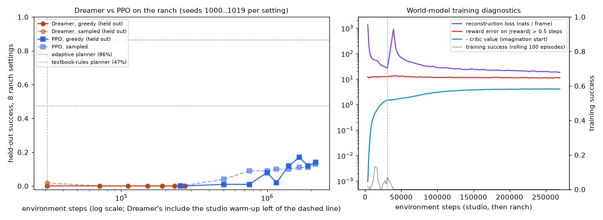

# DreamerV3: does a world model with memory beat PPO here?

**Status: tried and abandoned.** After the two attempts below (unguided, and with the replay seeded by the adaptive
planner) both gave 0% held-out success, the Dreamer work was stopped. Diagnosis in one line: the reward signal is lost
in the RSSM latent, while the same encoder and reward head without the RSSM learn the success reward from the same
data. The code (`dreamer.py`) and its tests (`tests/test_dreamer.py`, 30, passing) are kept as they are; nothing below
was rerun after the decision, except that the final verification checked a checkpoint still loads and plays an episode.

**Short answer, with this budget: no. DreamerV3 learned nothing usable.** After about 82 minutes of CPU training
(273k environment steps, 4,600 gradient updates) the policy succeeds in 0% of held-out ranch fires in every setting,
below PPO (42% dog / 7% kids with no novelty, after 2.2 M steps) and far below the Dijkstra planner (89% / 96%). It
did not even pass the studio sanity check: it beat a random policy only transiently (34% at 15k steps) and ended at
random level (1%). The diagnostics say why: in a few thousand updates the world model learned the static house but
not where the rescuer is or what ends an episode, so the policy trained inside it had nothing to learn from. This is
a budget result (the paper's runs use one to two orders of magnitude more updates), not proof that a world model
cannot help here, but nothing in these runs suggests that Dreamer would overtake PPO at equal CPU cost.

| | held-out success, ranch, 8 trained settings | env steps | wall clock (CPU) |
|---|---:|---:|---:|
| Dreamer (this work) | 0% greedy, 0% sampled | 273k (31k studio + 242k ranch) | 62 min for the reported chain, 82 min including the two failed studio runs |
| PPO at about the same env steps (`runs/ppo_nominal/step_253952.pt`, docs/RL.md) | 0% greedy, 0% sampled | 254k (150k studio + 104k ranch) | about 3.5 min |
| PPO, main policy | 14% greedy, 13% sampled | 2.16 M | 30 min |
| adaptive planner | 86% | none | none |

**Update: planner-guided Dreamer** (the replay seeded with the adaptive planner's episodes, tapered to zero) did not
change this: 0% held-out success in every setting. The world model ignores its input, so the reward signal never
reaches it. See [Planner-guided Dreamer](#planner-guided-dreamer-demo-seeded-replay-tapered-to-zero).

At equal env steps both learners are at zero; PPO is about 17x cheaper per env step on this machine and keeps
improving with more steps. Dreamer's advantage is supposed to be sample efficiency; I could not reach the regime
where it shows.



Left: held-out success on the 8 trained ranch settings (20 seeds each per point; PPO's points are the curve in
docs/RL.md, same protocol). Right: world-model training diagnostics. The reconstruction loss falls steadily (the
spike at the dashed line is the switch from the studio to the ranch), but the error on steps whose reward matters
(|reward| > 0.5: success, rescue, loss, death) never moves from about 12, and training success stays at 0 on the
ranch.

## Commands and wall clock

```bash
# studio warm-up (720 s, 31.0k env steps, 906 updates)
python scripts/train_dreamer.py --blueprint studio --profiles single --novelties none --steps 40000 \
    --train-ratio 32 --prefill 2000 --seed 0 --model-lr 3e-4 --critic-lr 1e-4 --actor-lr 3e-5 --threads 6 \
    --out runs/dreamer_studio_v2 --checkpoint-every 5000 --max-minutes 12
# ranch with novelties, one sampled per episode, as for PPO (3000 s, 241.7k env steps, 3,699 updates)
python scripts/train_dreamer.py --blueprint ranch --profiles single kids \
    --novelties none door_jam carpet_flashover hidden_dependent --steps 1000000 --train-ratio 16 --prefill 5000 \
    --seed 0 --model-lr 3e-4 --critic-lr 1e-4 --actor-lr 3e-5 --threads 6 \
    --init runs/dreamer_studio_v2/final.pt --out runs/dreamer_ranch --checkpoint-every 40000 --max-minutes 50
python scripts/dreamer_results.py --studio runs/dreamer_studio_v2 --ranch runs/dreamer_ranch \
    --ppo runs/ppo_novelty/final.pt                       # about 6 minutes; writes runs/dreamer_results.md
emberpath eval --profile single --agents baseline ppo dreamer --checkpoint runs/dreamer_ranch/final.pt ...
emberpath run --agent dreamer --checkpoint runs/dreamer_ranch/final.pt --seed 1000
```

(`emberpath eval` takes one `--checkpoint`, so compare PPO and Dreamer in separate calls or with the script.) The
ranch run was stopped by its wall-clock limit (`--max-minutes 50`), not by `--steps`. CPU was shared with another
agent's evaluations throughout. Train ratio 16 on the ranch means each env step was replayed 16 times; with a fixed
compute budget a higher ratio would have meant fewer env steps, not more updates. The two other studio runs
(`runs/dreamer_studio`, the paper's rates, 840 s; `runs/dreamer_studio_fast`, stopped after about 6 minutes) are
described under "Studio sanity check". Reward: the first studio run started 30 s before the other agent's fix to
the door-jam progress leak landed in `reward.py` (it had no novelty, so it is unaffected); every later run used the
fixed reward. Every Dreamer run (unguided and demo-seeded) predates the later end-of-episode potential fix
(docs/REWARD.md, "The end-of-episode potential": failed episodes no longer keep partial shaping credit) and was not
retrained; the held-out success and scores here do not depend on the reward.

## Held-out evaluation (ranch, seeds 1000..1099, the same seeds and fires for every agent)

`dreamer` = greedy action (latents sampled from a generator seeded per episode), `dreamer_sampled` = action sampled
too. PPO = `runs/ppo_novelty/final.pt` via `rl_baseline.ppo_factory`; baseline / oracle / adaptive are the planner.
Score = fraction rescued (0 if the rescuer died). `compound` was never trained on. Full table with timeouts and
returns: `runs/dreamer_results.md`.

| household | novelty | dreamer | dreamer_sampled | ppo | ppo_sampled | baseline | oracle | adaptive |
|---|---|---|---|---|---|---|---|---|
| dog | none | 0% / 0.00 / 9% / 145 | 0% / 0.00 / 7% / 144 | 42% / 0.42 / 4% / 110 | 45% / 0.45 / 9% / 108 | 89% / 0.89 / 1% / 44 | 89% / 0.89 / 1% / 44 | 89% / 0.89 / 1% / 44 |
| dog | door_jam | 0% / 0.00 / 9% / 145 | 0% / 0.00 / 7% / 145 | 3% / 0.03 / 5% / 141 | 2% / 0.02 / 7% / 142 | 6% / 0.06 / 0% / 138 | 89% / 0.89 / 1% / 56 | 86% / 0.86 / 2% / 60 |
| dog | carpet_flashover | 0% / 0.00 / 17% / 136 | 1% / 0.01 / 15% / 136 | 25% / 0.25 / 12% / 81 | 29% / 0.29 / 14% / 82 | 91% / 0.91 / 0% / 45 | 91% / 0.91 / 0% / 45 | 91% / 0.91 / 0% / 45 |
| dog | hidden_dependent | 0% / 0.00 / 9% / 145 | 0% / 0.00 / 7% / 144 | 5% / 0.35 / 2% / 136 | 8% / 0.35 / 9% / 137 | 0% / 0.45 / 1% / 145 | 82% / 0.89 / 3% / 74 | 88% / 0.93 / 2% / 63 |
| dog | compound | 0% / 0.00 / 16% / 137 | 0% / 0.00 / 14% / 138 | 0% / 0.00 / 13% / 134 | 0% / 0.00 / 14% / 134 | 0% / 0.00 / 0% / 128 | 52% / 0.52 / 2% / 50 | 35% / 0.35 / 4% / 47 |
| kids | none | 0% / 0.00 / 9% / 145 | 0% / 0.00 / 8% / 144 | 7% / 0.46 / 1% / 108 | 6% / 0.49 / 4% / 110 | 96% / 0.97 / 1% / 75 | 96% / 0.97 / 1% / 75 | 96% / 0.97 / 1% / 75 |
| kids | door_jam | 0% / 0.00 / 9% / 145 | 0% / 0.00 / 8% / 145 | 7% / 0.45 / 1% / 108 | 6% / 0.49 / 4% / 110 | 0% / 0.44 / 0% / 98 | 74% / 0.85 / 4% / 76 | 62% / 0.79 / 5% / 77 |
| kids | carpet_flashover | 0% / 0.00 / 17% / 136 | 0% / 0.00 / 14% / 137 | 0% / 0.36 / 8% / 95 | 0% / 0.47 / 6% / 93 | 97% / 0.98 / 0% / 74 | 97% / 0.98 / 0% / 74 | 97% / 0.98 / 0% / 74 |
| kids | hidden_dependent | 0% / 0.00 / 9% / 145 | 0% / 0.00 / 8% / 144 | 0% / 0.30 / 2% / 145 | 0% / 0.32 / 4% / 144 | 0% / 0.65 / 1% / 143 | 81% / 0.90 / 0% / 116 | 81% / 0.90 / 0% / 116 |
| kids | compound | 0% / 0.00 / 16% / 137 | 0% / 0.00 / 14% / 138 | 0% / 0.43 / 4% / 94 | 0% / 0.47 / 5% / 97 | 0% / 0.46 / 1% / 78 | 0% / 0.48 / 2% / 59 | 0% / 0.49 / 2% / 58 |

Each cell: success / score / rescuer died / mean steps. The PPO and planner numbers reproduce docs/RL.md's table on
the same seeds (the planner returns differ slightly where the reward fix applies; success and score are identical).

**Paired differences** (95% paired bootstrap over the 100 seeds, `evaluate.paired_bootstrap`):

| household | novelty | dreamer - ppo, success | dreamer - ppo, score | dreamer - adaptive, success | dreamer - adaptive, score |
|---|---|---|---|---|---|
| dog | none | -0.42 [-0.51, -0.33] | -0.42 [-0.51, -0.33] | -0.89 [-0.95, -0.82] | -0.89 [-0.95, -0.82] |
| dog | door_jam | -0.03 [-0.07, +0.00] | -0.03 [-0.07, +0.00] | -0.86 [-0.92, -0.79] | -0.86 [-0.92, -0.79] |
| dog | carpet_flashover | -0.25 [-0.34, -0.17] | -0.25 [-0.34, -0.17] | -0.91 [-0.96, -0.85] | -0.91 [-0.96, -0.85] |
| dog | hidden_dependent | -0.05 [-0.10, -0.01] | -0.35 [-0.40, -0.30] | -0.88 [-0.94, -0.81] | -0.93 [-0.96, -0.88] |
| dog | compound | +0.00 [+0.00, +0.00] | +0.00 [+0.00, +0.00] | -0.35 [-0.45, -0.26] | -0.35 [-0.45, -0.26] |
| kids | none | -0.07 [-0.12, -0.03] | -0.46 [-0.50, -0.41] | -0.96 [-0.99, -0.92] | -0.97 [-0.99, -0.94] |
| kids | door_jam | -0.07 [-0.12, -0.03] | -0.45 [-0.50, -0.41] | -0.62 [-0.71, -0.52] | -0.79 [-0.84, -0.72] |
| kids | carpet_flashover | +0.00 [+0.00, +0.00] | -0.36 [-0.40, -0.32] | -0.97 [-1.00, -0.93] | -0.98 [-1.00, -0.96] |
| kids | hidden_dependent | +0.00 [+0.00, +0.00] | -0.30 [-0.33, -0.27] | -0.81 [-0.88, -0.73] | -0.90 [-0.94, -0.85] |
| kids | compound | +0.00 [+0.00, +0.00] | -0.43 [-0.47, -0.40] | +0.00 [+0.00, +0.00] | -0.49 [-0.50, -0.47] |

Dreamer is below PPO on score in 8 of 10 settings with intervals that exclude zero; dog / door_jam is -0.03
[-0.07, +0.00] (PPO barely succeeds there either) and dog / compound is a tie at zero. It is below the adaptive
planner on score in every setting.

**Degradation when the novelty arrives** (score with the novelty minus without, paired bootstrap): Dreamer's is
+0.00 [+0.00, +0.00] in every row (+0.01 for dog / carpet sampled). That is not robustness: it scores 0 with or
without the novelty, so there is nothing to lose. For comparison PPO loses -0.39 [-0.48, -0.30] with the dog when a
door jams, and the adaptive agent -0.03 [-0.12, +0.06]. The full degradation table (every agent) is in
`runs/dreamer_results.md`.

**What the policy does.** It never leaves the starting room: 6 to 9 distinct cells per episode, "north" (into a
wall) on 65% of ticks, at 30-40% confidence. 91% of nominal episodes time out and 9% end with the rescuer dead
(17% on carpet_flashover, where the fire reaches the starting room). It never touched the door that jams (0% of
door_jam and compound episodes), so it could not have learned anything about the jam.

## Reward audit of the trained agent

All 1,000 held-out greedy ranch episodes, broken into components (`rl_baseline.episode_components`):

* **No success, so no top successful episode to inspect.** The best eight returns are all timeouts at -13.03 (dog,
  nobody lost to fire): time -3.00, progress -0.03, contact -10.00 for the dog left inside. Nothing pays above that.
* **By outcome:** timeouts (880) average -21.41 (contact -17.07, proximity -0.65, progress -0.70); rescuer deaths
  (120) average -22.56 (death charge -10.09). Dying is still worse than stalling, as designed.
* **No progress farming:** the largest progress total in any episode is +0.15; it waits on 0% of ticks.
* **Verdict: no exploit found**, but this policy is too weak to stress the reward: it explores almost nothing. The
  audit should be repeated if a stronger model-based learner is trained.

## World-model diagnostics on the final ranch model

First 30 held-out seeds per setting, the greedy agent's own episodes, model state rebuilt along the real trajectory
(`dreamer_results._diagnose_job`):

| household | novelty | reward error / step | open-loop 15-step reward error | last-step reward: real / predicted | continue prob. at the end / mid-episode | rescuer cell decoded | value at t=0 / real discounted return |
|---|---|---:|---:|---|---|---:|---|
| dog | none | 0.099 | 0.012 | -5.36 / -0.21 | 0.88 / 1.00 | 44% | -6.21 / -11.20 |
| dog | door_jam | 0.098 | 0.012 | -4.98 / -0.21 | 0.88 / 1.00 | 44% | -6.21 / -11.27 |
| dog | carpet_flashover | 0.121 | 0.039 | -3.16 / -0.25 | 0.86 / 1.00 | 42% | -6.21 / -12.15 |
| dog | hidden_dependent | 0.171 | 0.012 | -14.36 / -0.21 | 0.88 / 1.00 | 44% | -6.21 / -17.92 |
| kids | none | 0.174 | 0.009 | -9.98 / -0.18 | 0.91 / 1.00 | 43% | -6.21 / -19.29 |
| kids | hidden_dependent | 0.248 | 0.009 | -18.98 / -0.18 | 0.91 / 1.00 | 43% | -6.21 / -26.05 |

(Other settings are in `runs/dreamer_results.md` and look the same.) Read across: the model has learned the
per-tick costs (small per-step and open-loop errors, because almost every step pays about -0.02) and roughly when
episodes end (continue probability 0.86-0.91 on the final frame against 1.00 mid-episode), but not the large final
reward: it predicts about -0.2 where the real charge is -3 to -19. The critic's value at the start is the same
-6.21 in every setting against real discounted returns of -11 to -26: it has learned that episodes go badly on
average, not which states are worse. The rescuer is decoded in the right cell in 42-58% of frames, up from 0% on the
studio, so the representation was still improving when the budget ran out. There were no successful episodes, so
the reward head could not be checked on a success step in evaluation; in training, the error on steps with
|reward| > 0.5 (including the few studio successes) stayed at 11-13 throughout.

## Design

Code: `src/emberpath/dreamer.py` (model, training, `DreamerAgent`), `scripts/train_dreamer.py` (training CLI),
`scripts/dreamer_results.py` (tables, plot, diagnostics), `tests/test_dreamer.py`.

**Input and evidence discipline.** It gets exactly what PPO gets: `env.encode` without the smoke channel (10 channels:
wall, fire, burnt, agent, waiting dependent, following dependent, exit, door, bumped jam, time remaining), padded to
the 13x24 ranch canvas. `DreamerAgent` rebuilds it with `rl_baseline.encode_observation` from the `Observation`
and its own `Event`s (a jammed door appears only after its own bump), never from the world. A test checks that the
rebuilt input equals what training stored over a whole episode, and the lockstep test (same seed with and without
each novelty, both households, greedy and sampled) shows identical decisions while the inputs match. The agent
carries its recurrent state (h, z, previous action) across ticks. Every decision has a reason, e.g. "World model:
moving north (71% confident)."

Hearing is NOT in the input (the `occupied:<slot>` events are evidence an agent may use, but PPO's input does not
include them and the comparison was meant to be like for like). So the hidden visitor is invisible to both learned
agents until it is found; the only cue is that the episode does not end when the known dependents are out, which a
recurrent model can in principle notice and PPO cannot.

**The DreamerV3 pieces implemented** (Hafner et al. 2023, "Mastering Diverse Domains through World Models"):

| piece | here |
|---|---|
| RSSM | GRU deterministic state (256) + 16 categorical latents x 16 classes, 1% unimix, straight-through samples; the state resets at `is_first` |
| encoder / decoder | conv 3x3 (10 -> 16), conv 3x3 stride 2 (16 -> 32), linear -> 256, LayerNorm, SiLU; mirrored transposed-conv decoder |
| symlog | inputs are symlog-squashed; reward and value predictions are two-hot over 255 buckets uniform in symlog space on [-20, 20] (decoded with symexp) |
| decoder loss | per-cell binary cross-entropy on the 0/1 channels plus symlog-MSE on the clock channel, summed over cells (deviation: the paper uses MSE on pixels; this input is a grid of flags) |
| continue head | Bernoulli, target 1 - terminal; every ending in this env is a true termination |
| KL balancing | 0.5 x max(1, KL(sg(post) ‖ prior)) + 0.1 x max(1, KL(post ‖ sg(prior))), free bits = 1 nat |
| imagination | horizon 15 from 512 randomly chosen replayed posterior states per update (deviation: the paper uses all of them; halves the actor-critic cost on CPU) |
| returns | λ-returns, γ = 0.997, λ = 0.95, continue probabilities as discounts, trajectories weighted by the cumulative continue |
| return normalisation | advantages / max(1, S), S = EMA (0.99) of the 95th minus EMA of the 5th percentile of returns |
| actor | REINFORCE (discrete actions, no gradient through the model), entropy 3e-4, 1% unimix |
| critic | two-hot, regularised toward a slow EMA copy (decay 0.98, weight 1) |
| optimisers | Adam; world model 1e-4, actor and critic 3e-5 in the paper's setting (see runs below), gradient clip 1000 / 100 |
| replay | one stream per env slot, uniform windows of 64 steps (may cross episode boundaries; `is_first` resets the state), bit-packed, 1 M steps |
| train ratio | replayed steps per env step (each update replays 16 x 64 = 1024 steps); prefill 2000 random-action steps |

Deviations kept for CPU cost: `nn.GRUCell` without the paper's LayerNorm GRU, a tiny CNN, a 512-state imagination
subset, Adam instead of the paper's exact optimiser details. About 4 M parameters (most in the encoder/decoder
linears). One update takes about 0.6-0.8 s on this (shared) 8-core Mac with 3-4 torch threads, so the budget
allows only a few thousand updates: two orders of magnitude fewer than the paper's runs. That is the main caveat.

Determinism: one process, global torch seed, fixed thread count; the env slots use the PPO scheme (an RNG per slot
seeded by run seed and slot index picks the setting and a training fire seed from 0..999). Evaluation uses only
1000..1099 (asserted in training and in `evaluate_dreamer`). A test checks two tiny runs give identical weights.

## Studio sanity check (studio / dog / no novelty)

Held-out success on seeds 1000..1099 at every checkpoint (greedy = most likely action; sampled = actions drawn from
the policy; latents are sampled in both). A uniformly random policy gets 1% (and dies in 77% of fires); PPO's
throwaway probe on the studio reached 85% sampled.

| run | settings | 5k | 10k | 15k | 20k | 25k | 30k | final |
|---|---|---:|---:|---:|---:|---:|---:|---:|
| `runs/dreamer_studio` | paper rates (model 1e-4, actor and critic 3e-5), train ratio 32 | 1% | 7% | **34%** | 9% | 13% | | 1% (29.7k steps, 865 updates, 840 s) |
| `runs/dreamer_studio_fast` (stopped) | model 3e-4, actor and critic 1e-4 | 0% | 0% | | | | | stopped at 11.6k steps: actor entropy fell from 1.6 to 0.3 by update 300, training success 0% |
| `runs/dreamer_studio_v2` (warm-up for the ranch) | model 3e-4, critic 1e-4, actor 3e-5 | 1% | 2% | 11% | 1% | 6% | 4% | 1% (31.0k steps, 906 updates, 720 s) |

All numbers are the sampled policy; the greedy policy scored 0% at every checkpoint of both runs. **The sanity check
failed:** the policy beat random only transiently (34% at 15k steps) and fell back to random by the end of each run.
I did not pick a checkpoint by its held-out score (that would tune on the test seeds); every later stage starts
from the final checkpoint.

```bash
python scripts/train_dreamer.py --blueprint studio --profiles single --novelties none --steps 40000 \
    --train-ratio 32 --prefill 2000 --seed 0 --out runs/dreamer_studio --checkpoint-every 5000 --max-minutes 14
python scripts/train_dreamer.py --blueprint studio --profiles single --novelties none --steps 40000 \
    --train-ratio 32 --prefill 2000 --seed 0 --model-lr 3e-4 --critic-lr 1e-4 --actor-lr 3e-5 --threads 6 \
    --out runs/dreamer_studio_v2 --checkpoint-every 5000 --max-minutes 12
```

## Debugging: why it does not learn in this budget

What I checked, in order:

1. **Is the reward head learning the rewards that matter?** No. On held-out studio episodes the success and death
   steps pay -6.7 on average (deaths dominate) and the reward head predicts -0.11 there, the same as on every other
   step. During training the mean absolute error on steps with |reward| > 0.5 stayed at 11-13 for every logged
   interval of every run (right panel of the figure). The head has learned the marginal (-0.02 a tick plus small
   shaping), not the rewards that decide the task.
2. **Imagined vs real returns.** The critic's value at the first state of an episode was -0.3 (default run) and
   -1.6 (v2) against a real discounted return of -13 and -18. Imagined 15-step returns were about -1 to -2. So the
   actor optimises a model in which nothing much happens: advantages are tiny, and the policy drifts (entropy stays
   near uniform with the paper's actor rate, or collapses onto one action with a 3x higher rate).
3. **Is it a bug in the replay alignment or the agent path?** No. Each stored step is (frame, action that led to
   it, reward on arriving, is_first, is_terminal); the terminal frame is stored before reset (the PPO env slots
   drop it, so `dreamer._Envs` keeps it). Pushing the same held-out episode through the training-time loss gives the
   same reconstruction and the same rescuer-cell accuracy as the agent's own path.
4. **What is the world model actually encoding?** The rescuer's position, mostly not. The decoder's most likely
   rescuer cell is the true one in under 20% of training frames after 900 updates (0% on held-out studio
   episodes), while the reconstruction loss falls from about 2,000 to 25-30 nats per frame: the model learns the
   static house (walls, doors, exits, fire start) first. For the first 500-800 updates the posterior had collapsed:
   KL sat at the 1-nat free-bits floor, the posterior's most likely latent was the same on every frame of an
   episode, and the encoder's output varied by about 3% between frames that differ in a few cells. KL then rose to
   5-8 nats as the model started to encode the moving parts, which is where both studio runs ended.
5. **Is the encoder too weak?** Not the main problem. Trained alone as an autoencoder on the same frames (no RSSM),
   the CNN found the rescuer cell in 18% of frames after 300 updates of 256 frames; a full-resolution CNN with no
   stride got 6% and a plain MLP 17%. With the RSSM in the loop it was 2%. Summed per-cell losses on a mostly
   static grid learn the background first; the one-cell objects (rescuer, dog, children) come after many more
   updates than this budget allows. The MLP is about 7x cheaper per update than the CNN, which matters on a CPU.
6. **Learning rates.** The paper's rates assume tens of thousands of updates (Atari 100k at train ratio 1024 is
   about 100k updates); here there are about 900 on the studio and about 3,000 on the ranch. A 3x higher world-model
   rate made the representation learn faster (rescuer cell decoded in 82% of frames of held-out episodes after 300
   updates in the stopped run, though those episodes were short: its policy mostly walked into the fire), but raising the actor rate with it collapsed the policy before the model was useful. The ranch run
   uses model 3e-4, critic 1e-4, actor 3e-5, chosen from these studio diagnostics only, never from held-out scores.
7. **Greedy evaluation with the most likely latent.** My first agent used the posterior's mode when greedy. Because
   the mode barely changed within an episode, that agent was close to state-blind (it waited on 100% of ticks in one
   check). DreamerV3 samples latents when acting; the agent now always samples them from a seeded generator, and
   "greedy" refers only to the action.

## Verdict

* **vs PPO:** worse. At about the same number of env steps (254k vs 273k) both are at 0% held-out success on the
  ranch; PPO got there 17x faster in wall clock and went on to 14% (42% dog / nominal) by 2.2 M steps. Dreamer ended
  at 0% everywhere after 82 minutes of CPU, so it lost to PPO at equal steps (a tie at zero) and badly at equal
  compute. The hoped-for advantage, memory of a bump or a missing person, never had a chance to show, because the
  model did not get as far as representing the rescuer reliably.
* **vs the Dijkstra planner:** not close. The planner gets 89% / 96% on the nominal ranch from zero training, and the
  adaptive agent keeps 86% / 62% when a door jams. Dreamer's paired gap to the adaptive agent is -0.62 to -0.98 in
  score on every trained setting.
* **Is the implementation wrong?** The tests check the maths by hand (symlog/symexp, two-hot round trip, unimix,
  KL balancing and free-bits gradients, lambda-returns), shapes, replay round trips, determinism and that the losses
  fall on a tiny run, and the debugging above found no alignment or agent-path bug. What I cannot rule out from these
  runs is a subtler problem that only shows at scale. The fairest reading is "a compact DreamerV3, given
  about 4,600 updates, does not learn this task", not "DreamerV3 cannot".

## Negative results and caveats

* **The studio sanity check failed** (1% at the end of both completed runs, peak 34% at one checkpoint). I went on to
  the ranch anyway, as the comparison the task asked for, and say so here.
* **Budget, not tuning, is the limit.** About 0.7 s per update on a shared CPU allowed 906 updates on the studio
  and 3,699 on the ranch. The paper's settings assume tens of thousands. The decoder's loss is dominated by the
  static house for hundreds of updates; the moving one-cell objects and the rare large rewards come later.
* **Hyperparameters were changed once,** from the paper's rates to model 3e-4 / critic 1e-4 / actor 3e-5, based
  only on studio training diagnostics (posterior collapse, actor entropy). One seed per run; no search; nothing was
  chosen with the held-out seeds. A 3x higher actor rate collapsed the policy within 300 updates.
* **Same input as PPO, so no hearing.** The `occupied:<slot>` hearing events are legitimate evidence (the adaptive
  agent uses them) but are not in `env.encode`; I kept the input identical to PPO's for a like-for-like comparison.
  Adding a "heard someone here" channel is the obvious next step for any learner on `hidden_dependent`.
* **Not tried:** a per-cell MLP encoder/decoder (about 7x cheaper per update here and equally good at the start),
  weighting the decoder loss toward cells that change, a higher train ratio with more total compute, prioritised
  replay of rare large-reward steps, several seeds with intervals over seeds, or a GPU.
* The degradation table's +0.00 for Dreamer is a floor effect (0 with or without the novelty), not robustness.

## Planner-guided Dreamer (demo-seeded replay, tapered to zero)

**Short answer: no change. Seeding the replay with the adaptive planner's episodes did not make Dreamer learn
anything: 0% held-out success in every ranch setting at the end, and also at the moment the demo share hit 0.** It also
failed the studio sanity check again (0% vs random's 1%). The diagnostics show why more guidance could not help here:
the world model's reward head ignores its input. Trained on nothing but planner demos, it predicts the same +0.06 on
success steps (real +6.0), loss steps (real -6.7) and ordinary steps. The same encoder and the same kind of reward head
trained without the RSSM in between learn the success reward from the same data in 400 updates. The bottleneck is the
latent state, not a lack of rescues in the data.

### Design (`dreamer.py`, behind flags, defaults unchanged)

* **Demo source:** `collect_demos` plays `AdaptiveAgent` (the evidence-disciplined planner: Dijkstra on its own
  believed rules, repaired from its own events) through the same env on **training seeds 0..999 only**. The teacher is
  built without the world and gets only the `Observation` and `Event`s. `DEMO_TEACHERS = ("adaptive",)`: the oracle,
  and every other agent, is refused. Each episode is stored in the replay's own format (every frame including the
  terminal one, the action that led to it, the reward on arriving, first / terminal flags), so the world model sees
  rescues, successes, deaths and the timeout charge exactly as it would see its own.
* **Separate demo replay, mixed into world-model batches:** `sample_mixed` takes `round(16 x f)` of the 16 sequences
  per update from the demo replay and the rest from the agent's own replay. Imagination starts from every state in
  the batch, so the actor-critic also learns inside a model that has seen successes.
* **Taper:** `f` falls linearly from `--demo-frac 0.5` to **exactly 0** at `--demo-until` (default 60% of the run's
  planned steps) and stays 0 (`demo_fraction`). Because of the rounding, the first batch with no demo rows comes a
  little earlier (studio: step 16,883 of 18,000; ranch: step 101,268 of 108,000). The checkpoint at that update is
  saved as `demo_zero.pt`. The schedule, the demo rows per update and the totals are logged in `history.json`. **The
  last 44% of the ranch run (78.7k env steps, 1,231 updates) used only the agent's own experience.**
* **Acting is always autonomous.** No planner runs while the agent acts, at test time or in training. There is no goal
  or task-list input and no imitation loss (task items 2 and 3 were dropped by the user before I built them). The
  agent class is the same `DreamerAgent`; a test patches `HazardAwarePlanner`, `AdaptiveAgent`, `BaselineAgent`,
  `OracleAgent` and Dijkstra to raise and plays an episode, and checks that the input is exactly `encode_observation`
  of the observation and the agent's own events.
* **Hearing plane (`--heard`):** to match the best PPO's input, the main ranch run also reads `rl_baseline.with_heard`
  (1 on a hiding place whose latest `occupied:<slot>` hearing event said someone is calling), built from the agent's own
  events. It goes in before the clock, so the clock stays the last channel. A run without it isolates the effect of
  the demos against unguided Dreamer at equal input. A checkpoint without the plane can be widened (`load_dreamer` with
  `heard=True`): the new encoder weights start at zero, so it initially computes exactly what it did before (tested).
* **Reproducibility:** with the flags off, a tiny run's weights are bit-identical before and after this change
  (sha256 of the state dict checked). Old checkpoints load: config fields have defaults (tested on the real runs).

### Runs and the demo data the unguided learners did not get

| run | init | env steps | updates | wall clock | demo episodes (adaptive, training seeds) | demo transitions | demo steps replayed | demo share |
|---|---|---:|---:|---:|---:|---:|---:|---|
| `runs/dreamer_demo_studio` | scratch | 30.0k | 876 | 598 s | 300 (265 success) | 5,221 | 113,856 | 0.5 -> 0 by 18k (first all-own batch: step 16,883, update 465) |
| `runs/dreamer_demo_ranch` (with hearing) | demo studio, widened | 180.0k | 2,735 | 3,067 s | 1,200 (1,028 success) | 82,536 | 392,192 | 0.5 -> 0 by 108k (first all-own batch: step 101,268, update 1,504) |
| `runs/dreamer_demo_ranch_noheard` | demo studio | 180.0k | 2,735 | 3,061 s | 1,200 (same episodes) | 82,536 | 392,256 | same |

Demo collection took 1 s (studio) and 49 s (ranch, 2 processes). Total CPU training: 10 + 51 + 51 minutes (the two
ranch runs in parallel, 3 torch threads each, 4 for the studio), against the unguided chain's 62 minutes (31k + 242k
env steps). The ranch runs are 62k env steps shorter than the unguided ranch run.

```bash
python scripts/train_dreamer.py --blueprint studio --profiles single --novelties none --steps 30000 \
    --train-ratio 32 --prefill 2000 --seed 0 --model-lr 3e-4 --critic-lr 1e-4 --actor-lr 3e-5 --threads 4 \
    --out runs/dreamer_demo_studio --checkpoint-every 5000 --max-minutes 16 \
    --demo-frac 0.5 --demo-episodes 300 --demo-workers 3 --demo-data runs/dreamer_demo_studio/demos.pkl
python scripts/train_dreamer.py --blueprint ranch --profiles single kids \
    --novelties none door_jam carpet_flashover hidden_dependent --steps 180000 --train-ratio 16 --prefill 5000 \
    --seed 0 --model-lr 3e-4 --critic-lr 1e-4 --actor-lr 3e-5 --threads 3 --init runs/dreamer_demo_studio/final.pt \
    --checkpoint-every 30000 --max-minutes 62 --demo-frac 0.5 --demo-episodes 150 --demo-workers 2 \
    --heard --out runs/dreamer_demo_ranch --demo-data runs/dreamer_demo_ranch/demos.pkl
# the same without --heard, --out runs/dreamer_demo_ranch_noheard (its own demos.pkl)
python scripts/dreamer_results.py --guided-studio runs/dreamer_demo_studio --guided-ranch runs/dreamer_demo_ranch \
    --guided-ranch-noheard runs/dreamer_demo_ranch_noheard --studio runs/dreamer_studio_v2 --ranch runs/dreamer_ranch \
    --ppo runs/ppo_novelty/final.pt --ppo-best runs/bcppo/final.pt --workers 6 --md runs/dreamer_guided_results.md
python scripts/dreamer_results.py --probe runs/dreamer_demo_studio/demos.pkl   # the reward-signal probe, ~11 min
```

Hyperparameters are those of the unguided runs. The demo share (0.5), the taper end (60%) and the 150 demo episodes per
setting were fixed before any run, and nothing was tuned after looking at held-out seeds.

### Held-out results (ranch, seeds 1000..1099, same fires for every agent)

`demo` = demo-seeded with hearing, `demo (no hearing)` = the same without the plane, `@0` = the `demo_zero.pt`
checkpoint (the first update with no demo rows), `final` = after the all-own stretch. Greedy action unless marked
sampled. **BC+PPO** = `runs/bcppo/final.pt` (docs/RL.md "Improvements tried"): PPO warm-started by **behaviour cloning
of the adaptive agent**, so it also learned from the planner, and much more directly (imitation, not just replayed
data). It also has action masking and the hearing plane. Full table with every variant: `runs/dreamer_guided_results.md`.

| household | novelty | demo final | demo final, sampled | demo @0 | demo @0, sampled | demo (no hearing) final | unguided Dreamer | PPO | BC+PPO | baseline | adaptive |
|---|---|---|---|---|---|---|---|---|---|---|---|
| | | success / score | | | | | | | | | |
| dog | none | 0% / 0.00 | 0% / 0.00 | 0% / 0.00 | 10% / 0.10 | 0% / 0.00 | 0% / 0.00 | 42% / 0.42 | 93% / 0.93 | 89% / 0.89 | 89% / 0.89 |
| dog | door_jam | 0% / 0.00 | 0% / 0.00 | 0% / 0.00 | 0% / 0.00 | 0% / 0.00 | 0% / 0.00 | 3% / 0.03 | 89% / 0.89 | 6% / 0.06 | 86% / 0.86 |
| dog | carpet_flashover | 0% / 0.00 | 0% / 0.00 | 0% / 0.00 | 5% / 0.05 | 0% / 0.00 | 0% / 0.00 | 25% / 0.25 | 96% / 0.96 | 91% / 0.91 | 91% / 0.91 |
| dog | hidden_dependent | 0% / 0.00 | 0% / 0.00 | 0% / 0.00 | 0% / 0.05 | 0% / 0.00 | 0% / 0.00 | 5% / 0.35 | 97% / 0.98 | 0% / 0.45 | 88% / 0.93 |
| dog | compound | 0% / 0.00 | 0% / 0.00 | 0% / 0.00 | 0% / 0.00 | 0% / 0.00 | 0% / 0.00 | 0% / 0.00 | 25% / 0.25 | 0% / 0.00 | 35% / 0.35 |
| kids | none | 0% / 0.00 | 0% / 0.00 | 0% / 0.00 | 0% / 0.02 | 0% / 0.00 | 0% / 0.00 | 7% / 0.46 | 95% / 0.96 | 96% / 0.97 | 96% / 0.97 |
| kids | door_jam | 0% / 0.00 | 0% / 0.00 | 0% / 0.00 | 0% / 0.00 | 0% / 0.00 | 0% / 0.00 | 7% / 0.45 | 67% / 0.81 | 0% / 0.44 | 62% / 0.79 |
| kids | carpet_flashover | 0% / 0.00 | 0% / 0.00 | 0% / 0.00 | 0% / 0.00 | 0% / 0.00 | 0% / 0.00 | 0% / 0.36 | 97% / 0.97 | 97% / 0.98 | 97% / 0.98 |
| kids | hidden_dependent | 0% / 0.00 | 0% / 0.00 | 0% / 0.00 | 0% / 0.01 | 0% / 0.00 | 0% / 0.00 | 0% / 0.30 | 85% / 0.94 | 0% / 0.65 | 81% / 0.90 |
| kids | compound | 0% / 0.00 | 0% / 0.00 | 0% / 0.00 | 0% / 0.00 | 0% / 0.00 | 0% / 0.00 | 0% / 0.43 | 0% / 0.49 | 0% / 0.46 | 0% / 0.49 |
| **8 trained settings** | | **0% / 0.00** | 0% / 0.00 | 0% / 0.00 | 2% / 0.03 | 0% / 0.00 | 0% / 0.00 | 11% / 0.33 | 90% / 0.93 | 47% / 0.67 | 86% / 0.90 |

**Paired differences in score, demo-seeded final (greedy) minus each comparison** (95% paired bootstrap over the 100
seeds, `evaluate.paired_bootstrap`):

| household | novelty | - unguided Dreamer | - demo @0 | - PPO | - BC+PPO | - adaptive | demo (no hearing) - unguided |
|---|---|---|---|---|---|---|---|
| dog | none | +0.00 [+0.00, +0.00] | +0.00 [+0.00, +0.00] | -0.42 [-0.51, -0.33] | -0.93 [-0.98, -0.87] | -0.89 [-0.95, -0.82] | +0.00 [+0.00, +0.00] |
| dog | door_jam | +0.00 [+0.00, +0.00] | +0.00 [+0.00, +0.00] | -0.03 [-0.07, +0.00] | -0.89 [-0.95, -0.83] | -0.86 [-0.92, -0.79] | +0.00 [+0.00, +0.00] |
| dog | carpet_flashover | +0.00 [+0.00, +0.00] | +0.00 [+0.00, +0.00] | -0.25 [-0.34, -0.17] | -0.96 [-0.99, -0.92] | -0.91 [-0.96, -0.85] | +0.00 [+0.00, +0.00] |
| dog | hidden_dependent | +0.00 [+0.00, +0.00] | +0.00 [+0.00, +0.00] | -0.35 [-0.40, -0.30] | -0.98 [-1.00, -0.95] | -0.93 [-0.96, -0.88] | +0.00 [+0.00, +0.00] |
| dog | compound | +0.00 [+0.00, +0.00] | +0.00 [+0.00, +0.00] | +0.00 [+0.00, +0.00] | -0.25 [-0.34, -0.17] | -0.35 [-0.45, -0.26] | +0.00 [+0.00, +0.00] |
| kids | none | +0.00 [+0.00, +0.00] | +0.00 [+0.00, +0.00] | -0.46 [-0.50, -0.41] | -0.96 [-0.99, -0.92] | -0.97 [-0.99, -0.94] | +0.00 [+0.00, +0.00] |
| kids | door_jam | +0.00 [+0.00, +0.00] | +0.00 [+0.00, +0.00] | -0.45 [-0.50, -0.41] | -0.81 [-0.86, -0.74] | -0.79 [-0.84, -0.72] | +0.00 [+0.00, +0.00] |
| kids | carpet_flashover | +0.00 [+0.00, +0.00] | +0.00 [+0.00, +0.00] | -0.36 [-0.40, -0.32] | -0.97 [-1.00, -0.94] | -0.98 [-1.00, -0.96] | +0.00 [+0.00, +0.00] |
| kids | hidden_dependent | +0.00 [+0.00, +0.00] | +0.00 [+0.00, +0.00] | -0.30 [-0.33, -0.27] | -0.94 [-0.97, -0.90] | -0.90 [-0.94, -0.85] | +0.00 [+0.00, +0.00] |
| kids | compound | +0.00 [+0.00, +0.00] | +0.00 [+0.00, +0.00] | -0.43 [-0.47, -0.40] | -0.49 [-0.50, -0.48] | -0.49 [-0.50, -0.47] | +0.00 [+0.00, +0.00] |

The success differences have the same signs (in `runs/dreamer_guided_results.md`). The only nonzero Dreamer result
anywhere is the **sampled** policy at the demo-zero checkpoint: 10% on dog / none and 5% on dog / carpet_flashover. That
is +0.10 [+0.05, +0.16] and +0.05 [+0.01, +0.09] in success over the final sampled policy, which lost it again in the
all-own stretch. (Read with care: I looked at 2 checkpoints x 2 action modes x 8 settings, so one small positive is
expected by chance. Even taken at face value it is 2% over the 8 settings.) On the studio the demo-seeded policy got 0%
greedy and 0% sampled at every checkpoint (random 1%; paired vs random -0.01 [-0.03, +0.00]). **Sanity check failed.**

**Degradation when the novelty arrives:** +0.00 [+0.00, +0.00] for every demo-seeded checkpoint in every row, the same
floor effect as unguided Dreamer (0 with or without the novelty). For comparison: PPO -0.39 [-0.48, -0.30] (dog / door
jam), BC+PPO -0.04 [-0.11, +0.03], adaptive -0.03 [-0.12, +0.06].

**Teacher vs student:** the student gets 0.00 of the adaptive agent's 0.90 mean score on the trained settings. It
never beats the planner anywhere. The learner that did get close to the teacher, and beat it with a hidden visitor, is
BC+PPO, which imitates the teacher's actions directly.

**What the trained agent does, and the reward audit:** the greedy final policy never leaves its starting cell. It moves
into a wall on every tick (1.0 distinct cells per episode, 0% waits, largest progress total 0.00): 868 timeouts and 132
deaths in 1,000 episodes. The top-return episodes are dog timeouts at -13.00 (time -3, contact -10 for the dog left
inside, nothing else). **No exploit:** nothing pays above stalling, dying stays worse than stalling, and there is no
progress farming. This policy is too weak to stress the reward.

### Why the demos did not help: the reward never reaches the latent

1. **The demos were there.** Half the sequences of the early batches were planner episodes (392k demo steps replayed
   on the ranch; 86% of the demo episodes end in success, each with a rescue and a success reward). The training
   error on steps with |reward| > 0.5 still stayed at 7-12 throughout (`bigerr` in the logs, the same as unguided).
2. **The world model does not tell a rescue from any other step, even on the planner's own episodes.** Run along the
   adaptive agent's held-out episodes (it plays, the model only watches), all three ranch models (demo final, demo @0,
   unguided) predict -0.04 to -0.06 on the final step of successful episodes, where the real reward is +6.06. The
   continue head says 1.00 at the end and in the middle. On the studio demo data the reward head predicts the same
   number on success, loss and ordinary steps.
3. **Probe: the signal is lost in the RSSM** (`scripts/dreamer_results.py --probe`, studio demos, 250 episodes for
   training and 50 held back, same rate, 1,024 steps per update):

   | learner (same encoder, same two-hot reward head) | update 100 | 200 | 300 | 400 |
   |---|---|---|---|---|
   | full world model (RSSM), demos only: predicted reward on success steps (real +6.01) | +0.06 | +0.06 | +0.05 | +0.06 |
   | ... on loss steps (real -6.65) | +0.06 | +0.06 | +0.05 | +0.06 |
   | encoder on (previous frame, frame, action), no RSSM: on success steps | +0.06 | +1.68 | +4.99 | +5.48 |
   | ... on loss steps (real -6.70) | +0.06 | -0.01 | -0.48 | -3.40 |
   | ... on other steps (real -0.025) | +0.055 | -0.012 | -0.028 | -0.025 |

   Same data and same encoder; only the path through the RSSM differs. With the RSSM, the posterior's KL sits near the
   1-nat free-bits floor, and the reconstruction can fall without the latent carrying the frame at all, because the
   studio layout never changes. So the reward head sees features that do not depend on the frame and learns the
   marginal. The probe has an easier job (it sees both frames directly), so it bounds what is learnable rather than
   proving a bug. But it shows that the data contains the signal, and that the missing piece is the representation.
4. **So the user's diagnosis was half right.** Random exploration did starve the reward head of successes, and the
   demos fixed that. But a second, deeper problem sits behind it: the latent ignores the input. Guidance cannot fix
   that. The next thing to try is in the representation, not the data: decoder or reward-loss weighting toward the
   cells that change, a smaller free-bits floor, KL warm-up, or a deterministic embedding path to the heads.

### Evidence discipline

* Demos: only `AdaptiveAgent`, built without the world, on training seeds. Asserted in `collect_demos` and
  `train_dreamer`, and tested (oracle / baseline / naive_repair refused, held-out seeds refused, the teacher is never
  handed a world, a replayed demo reproduces the agent's decisions, rewards and ending, and its frames equal
  `env.encode`).
* The lockstep test on the trained checkpoints (`dreamer_results._lockstep_job`: every novelty x both households x
  seeds 1000, 1001 x greedy and sampled, 32 pairs each) found **no leaks** for `dreamer_demo_ranch/final.pt`,
  `dreamer_demo_ranch/demo_zero.pt`, `dreamer_demo_ranch_noheard/final.pt`, `dreamer_demo_ranch_noheard/demo_zero.pt`
  and `dreamer_demo_studio/final.pt`. The hearing plane passes the lockstep unit test on `hidden_dependent`, and its
  plane equals `with_heard` of the agent's own events over a whole episode.
* Tests added to `tests/test_dreamer.py` (11): demo source and seeds; demo fidelity; the taper reaches exactly 0 and
  stays there; batch mixing matches the fraction; training with demos is deterministic, saves `demo_zero.pt` and ends on
  own experience; demos put big rewards into the batch; no planner call at act time and the input is only
  `encode_observation`; old checkpoints (including ones without the new config fields) still load and act; the
  hearing input matches training; widening keeps behaviour; a hearing model trains and passes the lockstep.

### Verdict

* **vs unguided Dreamer:** identical, 0% everywhere (+0.00 [+0.00, +0.00] in every setting, with or without the
  hearing plane). The 82.5k planner transitions (392k replayed) bought nothing measurable.
* **vs PPO:** worse, as before (score -0.25 to -0.46 in 8 of 10 settings). **vs BC+PPO**, which also learned from
  the same teacher but by imitation: -0.25 to -0.98.
* **vs the planners:** 0.00 of the adaptive agent's 0.90. It never beats the planner.
* **Holding up without help:** there was nothing to hold up. The demo-zero and final checkpoints are both at 0% greedy.
  The sampled policy's 10% / 5% on two dog settings at demo-zero disappeared by the end.
* **Negative result, recorded as such.** The useful outcome is the diagnosis: in this compact DreamerV3 the RSSM
  latent does not carry the frame well enough for the reward head to use it, so neither more data nor better data
  helps. That is where the next effort should go.
