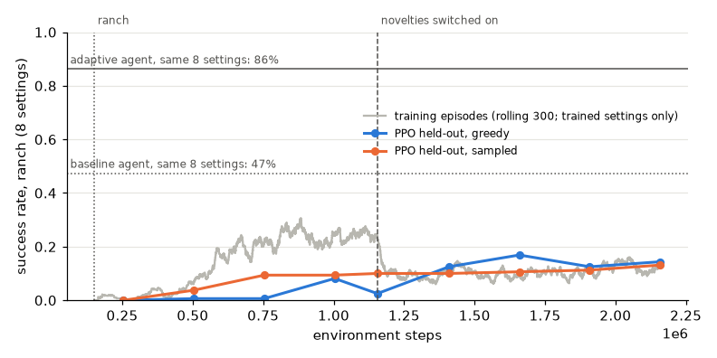

# Deep-RL baseline (PPO): why not just use RL?

**Short answer, with this budget: PPO is far below the planner agents.** After 2.2 M environment steps (about 30
minutes on 8 CPU cores) the trained policy gets everyone out in 42% of held-out ranch fires with the dog and 7% with
the two children. The textbook-rules planner (`baseline`) gets 89% and 96% on the same seeds, and the adaptive agent
keeps 86% and 62% when a door jams, where PPO falls to 3% and 7%. PPO also does not learn a jammed-door or a
hidden-visitor episode from 1 M further steps with those novelties in the mix, while the adaptive agent repairs its
rulebook within 5 and 11 ticks of the change, inside the same episode. This is a modest CPU budget and an untuned
setup (one seed, no hyperparameter search), so read it as "a plain PPO baseline does not come close at this cost",
not as a ceiling on what RL could reach.

**Update: see [Improvements tried](#improvements-tried).** A behaviour-cloning warm start from the adaptive agent,
plus PPO fine-tuning, matches the planner in every trained setting and beats it on the dog with a hidden visitor (one
training seed). The paragraph above describes PPO from scratch.

Everything here is reproducible with the commands below; tables come from `scripts/ppo_results.py`, which writes
`runs/ppo_results.md` (gitignored) and the plot.

## Setup

* **Code:** `src/emberpath/rl_baseline.py` (PPO, the `PPOAgent`, evaluation), `scripts/train_ppo.py` (same as
  `python -m emberpath.rl_baseline`), `scripts/ppo_results.py` (tables and plot), `tests/test_rl_baseline.py`.
* **Observation:** `env.encode`, 11 channels: wall, fire, burnt, smoke, agent, waiting dependent, following
  dependent, exit, door, bumped jam, and (new, appended as channel 10) **time remaining** = (150 - t) / 150 on every
  cell. The policy drops the smoke channel: `Observation` only carries smoke at the rescuer's cell, so an agent run
  through the harness could not rebuild it (smoke has no effect on the dynamics under full observation). Houses
  smaller than the training canvas (studio inside 13x24) are padded with wall.
* **Why the time channel:** an earlier throwaway probe on studio (no time feature) reached 85% success when sampling
  actions but 0% when taking the most likely action: the greedy policy walked into a wall forever because the same
  layout at tick 3 and tick 90 looked identical. The rescuer knows the clock, so the clock is now in the
  observation. With it the final greedy policy is about as good as the sampled one (table below); I did not rerun the
  ranch without it, so this is not a controlled ablation.
* **Evidence discipline:** `PPOAgent` rebuilds the policy input from the `Observation` and its own `Event`s (a
  jammed door appears only after the agent's own bump event), never from the world. A test checks the rebuilt
  input equals `env.encode` on every policy channel over whole episodes, and the lockstep test (same seed with and
  without a novelty) shows identical decisions while the inputs match. Every decision has a reason such as
  "Learned policy: moving east (68% confident)."
* **Network:** conv 3x3 (10 -> 16), conv 3x3 stride 2 (16 -> 32), linear (32 * 7 * 12 -> 256), heads for 5 action
  logits and a value. Orthogonal init (policy head gain 0.01).
* **PPO:** GAE (gamma 0.99, lambda 0.95), clip 0.2, value loss coefficient 0.5, entropy bonus 0.01, Adam lr 3e-4
  annealed linearly to 3e-5 over each run, 4 epochs of 512-sample minibatches per update, 32 envs x 128 steps =
  4096 steps per update, gradient-norm clip 0.5, rewards scaled by 0.1 for the learning targets only (all reported
  returns are unscaled). Every episode end is a true termination (the env never truncates), so nothing is
  bootstrapped across it.
* **Envs and seeds:** 32 env slots stepped by `os.cpu_count()` (8) worker processes. Each slot has its own RNG
  (run seed, slot index) that picks the next episode's setting and fire seed, so a run is identical however the
  slots are split over processes. Training fires come from seeds 0..999 only; every evaluation uses 1000..1099
  (disjointness is asserted in the module, at the end of training, and in `evaluate_policy`). Deterministic on CPU
  for a fixed torch thread count (4).

### Curriculum and the two runs

| run | phase | settings (one sampled per episode) | env steps | wall clock |
|---|---|---|---:|---:|
| `runs/ppo_nominal` ("frozen") | warm-up | studio / dog, no novelty | 150k | |
| | ranch | ranch / {dog, kids}, no novelty | 1.0 M | 926 s total |
| `runs/ppo_novelty` ("keeps learning", main) | ranch + novelties | ranch / {dog, kids} x {none, door_jam, carpet_flashover, hidden_dependent}, starting from the frozen policy | 1.0 M | 850 s |

```bash
python scripts/train_ppo.py --blueprint ranch --profiles single kids --novelties none \
    --warmup-steps 150000 --steps 1000000 --seed 0 --out runs/ppo_nominal
python scripts/train_ppo.py --blueprint ranch --profiles single kids \
    --novelties none door_jam carpet_flashover hidden_dependent \
    --warmup-steps 0 --steps 1000000 --seed 0 --init runs/ppo_nominal/final.pt --out runs/ppo_novelty
python scripts/ppo_results.py --nominal runs/ppo_nominal --novelty runs/ppo_novelty     # about 3 minutes
emberpath eval --profile kids --novelty door_jam --agents baseline adaptive ppo \
    --checkpoint runs/ppo_novelty/final.pt --seeds 100 --seed-start 1000                 # one cell, by hand
emberpath run --profile single --agent ppo --checkpoint runs/ppo_novelty/final.pt --seed 1000 --gif /tmp/ppo.gif
```

Total training wall clock: 1776 s (29.6 min) on an 8-core Mac, about 1,250 env steps per second; the PPO update,
not the simulator, is the bottleneck. Checkpoints (2.8 MB each) live in `runs/`, which is gitignored.

The novelty presets fire early (door jam at t=1, carpet at t=2, the hidden visitor from t=0, `compound` adds the
carpet change at t=10), so "mid-run" here means after the episode has started and before the rescuer can know:
the observation does not change until the rescuer bumps the door, sees fire race, or hears the visitor.

## Learning curve



Held-out success (20 seeds from 1000.. x the 8 trained ranch settings, so 160 episodes per point) at every checkpoint.
The x axis counts every step including the studio warm-up; the dashed line is where novelties were switched on.
The grey line is training success (rolling 300 episodes, only the settings in training at that point). Horizontal
lines: the adaptive agent (86%) and the textbook-rules baseline (47%) on the same 8 settings and seeds 1000..1099.

| env steps | greedy | sampled |
|---:|---:|---:|
| 254k | 0% | 0% |
| 504k | 1% | 4% |
| 754k | 1% | 9% |
| 1.00 M | 8% | 9% |
| 1.16 M (frozen policy) | 2% | 10% |
| 1.41 M | 12% | 10% |
| 1.66 M | 17% | 11% |
| 1.91 M | 12% | 11% |
| 2.16 M (main policy) | 14% | 13% |

Training success on the nominal ranch climbed from 0 to about 22-29% (rolling, both households) by 1 M ranch
steps, almost all of it from the dog household. Once novelties were mixed in, training success fell to about 10%
and was still flat at the end of the second run. The policy had not converged; a longer run might still improve.

## Held-out evaluation (ranch, seeds 1000..1099, same seeds and fires for every agent)

`ppo` = main policy, greedy; `ppo_sampled` = same policy, sampled; `ppo_frozen` = the policy trained without
novelties. Score = fraction rescued (0 if the rescuer died). `compound` was never trained on.

| household | novelty | agent | success | score | rescuer died | steps |
|---|---|---|---:|---:|---:|---:|
| dog | none | ppo | 42% | 0.42 | 4% | 110 |
| | | ppo_sampled | 45% | 0.45 | 9% | 108 |
| | | ppo_frozen | 24% | 0.24 | 8% | 128 |
| | | baseline = oracle = adaptive | 89% | 0.89 | 1% | 44 |
| dog | door_jam | ppo | 3% | 0.03 | 5% | 141 |
| | | ppo_sampled | 2% | 0.02 | 7% | 142 |
| | | ppo_frozen | 0% | 0.00 | 9% | 144 |
| | | baseline | 6% | 0.06 | 0% | 138 |
| | | oracle | 89% | 0.89 | 1% | 56 |
| | | adaptive | 86% | 0.86 | 2% | 60 |
| dog | carpet_flashover | ppo | 25% | 0.25 | 12% | 81 |
| | | ppo_sampled | 29% | 0.29 | 14% | 82 |
| | | ppo_frozen | 6% | 0.06 | 13% | 136 |
| | | baseline = oracle = adaptive | 91% | 0.91 | 0% | 45 |
| dog | hidden_dependent | ppo | 5% | 0.35 | 2% | 136 |
| | | ppo_sampled | 8% | 0.35 | 9% | 137 |
| | | ppo_frozen | 0% | 0.12 | 8% | 142 |
| | | baseline | 0% | 0.45 | 1% | 145 |
| | | oracle | 82% | 0.89 | 3% | 74 |
| | | adaptive | 88% | 0.93 | 2% | 63 |
| dog | compound (untrained) | ppo | 0% | 0.00 | 13% | 134 |
| | | baseline | 0% | 0.00 | 0% | 128 |
| | | oracle | 52% | 0.52 | 2% | 50 |
| | | adaptive | 35% | 0.35 | 4% | 47 |
| kids | none | ppo | 7% | 0.46 | 1% | 108 |
| | | ppo_sampled | 6% | 0.49 | 4% | 110 |
| | | ppo_frozen | 0% | 0.10 | 4% | 139 |
| | | baseline = oracle = adaptive | 96% | 0.97 | 1% | 75 |
| kids | door_jam | ppo | 7% | 0.45 | 1% | 108 |
| | | ppo_sampled | 6% | 0.49 | 4% | 110 |
| | | baseline | 0% | 0.44 | 0% | 98 |
| | | oracle | 74% | 0.85 | 4% | 76 |
| | | adaptive | 62% | 0.79 | 5% | 77 |
| kids | carpet_flashover | ppo | 0% | 0.36 | 8% | 95 |
| | | ppo_sampled | 0% | 0.47 | 6% | 93 |
| | | baseline = oracle = adaptive | 97% | 0.98 | 0% | 74 |
| kids | hidden_dependent | ppo | 0% | 0.30 | 2% | 145 |
| | | ppo_sampled | 0% | 0.32 | 4% | 144 |
| | | baseline | 0% | 0.65 | 1% | 143 |
| | | oracle = adaptive | 81% | 0.90 | 0% | 116 |
| kids | compound (untrained) | ppo | 0% | 0.43 | 4% | 94 |
| | | baseline | 0% | 0.46 | 1% | 78 |
| | | oracle | 0% | 0.48 | 2% | 59 |
| | | adaptive | 0% | 0.49 | 2% | 58 |

The full table (every agent in every row, timeouts and mean returns) is in `runs/ppo_results.md` after running the
script.

What the table says:
* **PPO is far below every planner agent whenever the planner works.** With no novelty it reaches 42% (dog) and 7%
  (kids) against 89% and 96%, and its episodes last 2.5x and 1.4x as long on average. With the kids it learned to bring one child out
  and lose the other (score 0.46, mostly "partial" endings): a local optimum, not a strategy.
* **Greedy vs sampled:** with the time channel the main policy's greedy and sampled success are close (42% vs 45%
  on dog/none). The frozen policy still gains from sampling (24% vs 46%), which suggests it had not yet become
  confident.
* **Training with novelties helped a little on what it can see.** Against the frozen policy, the main policy gains
  on carpet_flashover with the dog (25% vs 6% greedy) and on the nominal house, but not on door_jam (3% vs 0%) or the
  hidden visitor.

### How much PPO degrades when the novelty arrives (score with novelty minus score without)

| household | novelty | ppo | ppo_sampled | ppo_frozen | baseline | oracle | adaptive |
|---|---|---:|---:|---:|---:|---:|---:|
| dog | door_jam | -0.39 | -0.43 | -0.24 | -0.83 | +0.00 | -0.03 |
| dog | carpet_flashover | -0.17 | -0.16 | -0.18 | +0.02 | +0.02 | +0.02 |
| dog | hidden_dependent | -0.07 | -0.10 | -0.12 | -0.44 | +0.00 | +0.04 |
| dog | compound | -0.42 | -0.45 | -0.24 | -0.89 | -0.37 | -0.54 |
| kids | door_jam | -0.01 | +0.00 | +0.00 | -0.53 | -0.12 | -0.19 |
| kids | carpet_flashover | -0.10 | -0.02 | -0.05 | +0.01 | +0.01 | +0.01 |
| kids | hidden_dependent | -0.16 | -0.17 | -0.03 | -0.32 | -0.08 | -0.08 |
| kids | compound | -0.02 | -0.02 | -0.07 | -0.52 | -0.49 | -0.48 |

With the dog, a jammed door wipes out almost everything PPO had (0.42 -> 0.03): 57% of its door_jam episodes bump
the jammed door and almost none then find the detour. PPO's small drops in other rows are small because it had
little to lose: with the kids it never uses the door that jams (1% of episodes, also without the novelty), so the
jam cannot hurt it. Those small drops are not robustness. The adaptive agent loses at most 0.19 in any trained row
and starts far higher.

### Keeps learning: does continued training recover?

Target: 90% of the frozen run's training success on the nominal ranch over its last 400 episodes (22%, so the target
is 20%), measured as the rolling success over a novelty's last 100 training episodes, both households.

| novelty | training success, first 100 episodes after the switch | env steps to recover | episodes of that novelty |
|---|---:|---:|---:|
| none (control) | 23% | 50k | 100 |
| carpet_flashover | 18% | 112k | 254 |
| door_jam | 0% | not reached in 1 M | 2,284 seen |
| hidden_dependent | 0% | not reached in 1 M | 2,236 seen |

For comparison, the adaptive agent edits the right rule a median 5 ticks after the door jams, 3 ticks after the
carpet changes and 11 ticks after the visitor hides (docs/adaptive_study.md), in the episode where it happens and
from that episode's evidence alone. PPO needed about 250 carpet episodes to get back to a low bar, and had not
recovered on the other two after more than 2,000 episodes each. That is the sample-cost answer the work package
asked for.

## Reward audit of the trained agent (R10)

What I inspected: the per-component breakdown of all 2,000 held-out evaluation episodes of the main policy (100
seeds x 10 settings x greedy and sampled), the top 8 by return, the top 8 by return that did not end in success,
mean components by outcome, how often it waits and how often it revisits cells, and the same scan over all 20,528
training episodes of both runs.

* **Best episodes are genuine rescues.** The top 8 are all full successes with the kids (return +6.26 to +6.46):
  time -1.6 to -1.8, progress +1.08, rescue +2, success +5, no proximity or contact charge. Progress is +1.08 in
  every one of them, which is what telescoping predicts (the potential at the end minus at the start of that layout),
  so no progress was farmed. The largest progress total in any training episode is 1.14.
* **No failure looks like a win.** The best non-success in evaluation and in training is -9.92 (kids /
  hidden_dependent: both children out, the visitor never found, timeout charged -10 for the visitor). The worst
  success in training is +0.73 (nominal run) and +1.76 (novelty run). Nothing scored between them.
* **Dying does not pay.** Episodes where the rescuer died average -20.6, below timeouts (-17.8) and partial rescues
  (-13.6). The death charge (-6.6 on average) works as designed.
* **No hovering or dawdling.** PPO waits 18-20% of its ticks against the planner's 30%. It does revisit cells more
  (65% of cells on a successful path are revisits against 43% for the planner), so it wanders, which the time cost
  already charges; it is not paid for.
* **The one thing the reward does reward that people would not want, by degree, is leaving a child behind.** With
  the kids PPO settles on bringing one child out (906 "partial" endings). The reward charges this heavily (-13.6 on
  average against +4.4 for a success), so it is a learning failure, not an exploit: a full rescue is worth about 18
  more. No new degenerate policy or reward change was needed. `make audit` still passes.

**Verdict: no exploit found.** How hard I looked: one trained policy, 2,000 held-out episodes and 20,528 training
episodes read through the component breakdown and the probes above. A stronger policy could find things this weak
one could not reach, so the audit should be repeated if a better learner is trained.

### The door-jam leak in the progress term

`docs/REWARD.md` (Limitations) notes the progress potential uses the TRUE jammed doors, so the reward changes when
a door jams, before the rescuer has touched it. I did not change `reward.py`. What I saw:

* **At test time the policy cannot use it.** The policy only sees `encode`; the lockstep test shows identical
  decisions with and without the jam until the bump.
* **No sign it shaped training.** If the leak taught the policy to avoid the door that jams, the effect should
  appear in the policy that saw door_jam episodes and not in the frozen one, which never did. With the kids both
  avoid that door (1% of episodes for each, with or without the novelty), so that avoidance is not from the leak.
  With the dog, the frozen policy goes through that door in 95% of nominal episodes and the main policy in 62% (75%
  sampled). That drop could come from the leak or from the real, observable cost of bumping a jammed door in a
  quarter of training episodes. This test cannot tell them apart. The main policy still bumps the jammed door in
  57% of door_jam episodes, so it did not learn to avoid it in advance.
* Verdict: no evidence it mattered for this policy. It is still a real channel for any learner that is fed its
  rewards, and the separate reward audit should decide whether to close it.
* **Update (independent verification below):** the reward audit closed it. The potential now uses only jams the
  rescuer has bumped into (`reward.known_jams`); the checkpoints in `runs/` were trained before that fix.

## Negative results and caveats

* **PPO does not learn this task well in 2.2 M steps.** Kids success never exceeded 7% on held-out fires; the hidden
  visitor and door jam were never learned. The curve was still rising slowly, so this is a budget result, not a
  proof that PPO cannot learn it.
* **One training seed, no tuning.** The architecture was shrunk (stride-2 second conv) for CPU speed; the probe's
  larger network on studio learned faster per step. Hyperparameters are standard defaults; I did not search them,
  and I would not tune them against these held-out seeds.
* **Forgetting:** after the ranch phase the policy no longer solves the studio well (held-out sampled success on
  studio fell to 37% at 250k steps, from 85% in the earlier probe that trained only there).
* **The time channel is a change to `env.encode`** (channel 10, appended; channels 0-9 unchanged). Anything that
  assumed 10 channels must use `env.N_CHANNELS`.
* **Not tried here:** reward normalisation, longer runs, several seeds with intervals. (Recurrent policies, a
  behaviour-cloning warm start and action masking were tried later; see "Improvements tried".)

## Independent verification

A second agent rechecked this document from the saved checkpoints rather than from `scripts/ppo_results.py`
(throwaway scripts; every number below is from `evaluate.run_episode`, the shared harness, on seeds 1000..1099).
`ppo` = `runs/ppo_novelty/final.pt` greedy, `ppo_sampled` = the same policy sampled (seeded per episode). Brackets
are 95% paired-bootstrap intervals over the 100 seeds (`evaluate.paired_bootstrap`, 2,000 resamples).

### PPO against the Dijkstra planner (baseline, oracle and adaptive are the same `HazardAwarePlanner`)

| setting | baseline | oracle | adaptive | ppo | ppo_sampled |
|---|---|---|---|---|---|
| | success / score / died / steps | | | | |
| ranch / dog / none | 89% / 0.89 / 1% / 44 | same | same | 42% / 0.42 / 4% / 110 | 45% / 0.45 / 9% / 108 |
| ranch / dog / door_jam | 6% / 0.06 / 0% / 138 | 89% / 0.89 / 1% / 56 | 86% / 0.86 / 2% / 60 | 3% / 0.03 / 5% / 141 | 2% / 0.02 / 7% / 142 |
| ranch / dog / carpet_flashover | 91% / 0.91 / 0% / 45 | same | same | 25% / 0.25 / 12% / 81 | 29% / 0.29 / 14% / 82 |
| ranch / dog / hidden_dependent | 0% / 0.45 / 1% / 145 | 82% / 0.89 / 3% / 74 | 88% / 0.93 / 2% / 63 | 5% / 0.35 / 2% / 136 | 8% / 0.35 / 9% / 137 |
| ranch / kids / none | 96% / 0.97 / 1% / 75 | same | same | 7% / 0.46 / 1% / 108 | 6% / 0.49 / 4% / 110 |
| ranch / kids / door_jam | 0% / 0.44 / 0% / 98 | 74% / 0.85 / 4% / 76 | 62% / 0.79 / 5% / 77 | 7% / 0.45 / 1% / 108 | 6% / 0.49 / 4% / 110 |
| ranch / kids / carpet_flashover | 97% / 0.98 / 0% / 74 | same | same | 0% / 0.36 / 8% / 95 | 0% / 0.47 / 6% / 93 |
| ranch / kids / hidden_dependent | 0% / 0.65 / 1% / 143 | 81% / 0.90 / 0% / 116 | same as oracle | 0% / 0.30 / 2% / 145 | 0% / 0.32 / 4% / 144 |
| *untrained:* ranch / dog / compound | 0% / 0.00 / 0% / 128 | 52% / 0.52 / 2% / 50 | 35% / 0.35 / 4% / 47 | 0% / 0.00 / 13% / 134 | 0% / 0.00 / 14% / 134 |
| *untrained:* ranch / kids / compound | 0% / 0.46 / 1% / 78 | 0% / 0.48 / 2% / 59 | 0% / 0.49 / 2% / 58 | 0% / 0.43 / 4% / 94 | 0% / 0.47 / 5% / 97 |
| *untrained household:* ranch / married / none | 94% / 0.94 / 2% / 34 | same | same | 38% / 0.88 / 6% / 121 | 56% / 0.89 / 7% / 119 |
| *warm-up house, forgotten:* studio / dog / none | 90% / 0.90 / 1% / 17 | same | same | 0% / 0.00 / 73% / 56 | 9% / 0.09 / 75% / 45 |

"same" = identical to baseline on every seed (no novelty, or a novelty that does not change the plan).

| setting | ppo - baseline (score) | ppo - oracle | ppo - adaptive | ppo_sampled - baseline | ppo - baseline (success) | ppo steps / oracle steps, joint successes |
|---|---|---|---|---|---|---|
| dog / none | -0.47 [-0.58, -0.36] | -0.47 [-0.58, -0.36] | -0.47 [-0.58, -0.36] | -0.44 [-0.56, -0.32] | -0.47 [-0.58, -0.36] | 1.92 [1.71, 2.15] (n=36) |
| dog / door_jam | -0.03 [-0.09, +0.03] | -0.86 [-0.92, -0.79] | -0.83 [-0.90, -0.75] | -0.04 [-0.09, +0.01] | -0.03 [-0.09, +0.03] | 1.57 [1.42, 1.75] (n=3) |
| dog / carpet_flashover | -0.66 [-0.75, -0.56] | -0.66 [-0.75, -0.56] | -0.66 [-0.75, -0.56] | -0.62 [-0.71, -0.52] | -0.66 [-0.75, -0.56] | 1.61 [1.46, 1.76] (n=24) |
| dog / hidden_dependent | -0.10 [-0.16, -0.04] | -0.54 [-0.60, -0.47] | -0.58 [-0.64, -0.51] | -0.10 [-0.17, -0.03] | +0.05 [+0.01, +0.10] | 1.44 [1.32, 1.56] (n=5) |
| kids / none | -0.52 [-0.57, -0.47] | -0.52 [-0.57, -0.47] | -0.52 [-0.57, -0.47] | -0.48 [-0.52, -0.44] | -0.89 [-0.95, -0.82] | 1.44 [1.34, 1.55] (n=7) |
| kids / door_jam | +0.01 [-0.05, +0.08] | -0.40 [-0.47, -0.33] | -0.34 [-0.41, -0.26] | +0.05 [-0.01, +0.12] | +0.07 [+0.03, +0.12] | 1.45 [1.35, 1.56] (n=7) |
| kids / carpet_flashover | -0.62 [-0.67, -0.58] | -0.62 [-0.67, -0.58] | -0.62 [-0.67, -0.58] | -0.52 [-0.54, -0.49] | -0.97 [-1.00, -0.93] | no joint successes |
| kids / hidden_dependent | -0.35 [-0.38, -0.31] | -0.60 [-0.64, -0.55] | -0.60 [-0.64, -0.55] | -0.33 [-0.35, -0.30] | +0.00 [+0.00, +0.00] | no joint successes |
| dog / compound | +0.00 [+0.00, +0.00] | -0.52 [-0.62, -0.42] | -0.35 [-0.45, -0.26] | +0.00 [+0.00, +0.00] | +0.00 [+0.00, +0.00] | no joint successes |
| kids / compound | -0.02 [-0.05, +0.02] | -0.05 [-0.09, -0.02] | -0.05 [-0.09, -0.02] | +0.01 [-0.02, +0.05] | +0.00 [+0.00, +0.00] | no joint successes |
| married / none | -0.06 [-0.12, +0.00] | -0.06 [-0.12, +0.00] | -0.06 [-0.12, +0.00] | -0.05 [-0.11, +0.00] | -0.56 [-0.65, -0.46] | 2.55 [2.28, 2.82] (n=37) |
| studio / dog / none | -0.90 [-0.96, -0.84] | -0.90 [-0.96, -0.84] | -0.90 [-0.96, -0.84] | -0.81 [-0.88, -0.73] | -0.90 [-0.96, -0.84] | no joint successes |

**Verdict: PPO does not beat the Dijkstra planner anywhere.** Every PPO number in the held-out table above
reproduces exactly (same success, score, death rate and mean steps in every row). Against the oracle and the adaptive
agent PPO is lower on score in all 12 settings, with every interval below zero. Against the stale-rules baseline it
is lower or tied on score everywhere; the two positive success differences (kids / door_jam +0.07 [+0.03, +0.12], dog
/ hidden_dependent +0.05 [+0.01, +0.10]) are settings where that baseline is stuck at about 0% because its rulebook is
wrong, and PPO's score there is still tied (+0.01) or lower (-0.10). When both succeed, PPO takes 1.4x to 2.6x as many
steps as the oracle. Two new observations: on the untrained married household PPO's score is close to the planner's
(0.88 vs 0.94) because the spouse walks out by herself, but PPO gets everyone out only 38% of the time against 94%; and
on the studio, where it warmed up, the final policy dies in 73% of fires (forgetting, as the caveats say, and worse
than the 37% sampled success at 250k steps suggested).

### Is the comparison fair?

* **No hidden truth reaches PPO.** The lockstep test of `tests/test_evidence_discipline.py` (novelty world and control,
  same seed, stepped while the agent's inputs are identical) run with the real checkpoint, greedy and sampled: 680
  paired episodes (ranch and studio, every household and novelty that applies, seeds 1000..1009), 16,165 ticks of
  identical input, 0 differing decisions. `PPOAgent` holds no reference to the world (its attributes: `bp`, `bumped`,
  `canvas`, `greedy`, `max_steps`, `name`, `policy`, `rng`), and `ppo_factory` discards the world it is offered.
* **Evaluation seeds are disjoint from training.** Both `history.json` files: 11,411 and 9,117 training episodes, fire
  seeds 0..999 only, none in 1000..1099. `evaluate_policy` refuses training seeds and the module asserts disjointness.
* **PPO is not handicapped by its input.** `encode_observation` (what `PPOAgent` rebuilds from the `Observation` and its
  own events) was compared with `env.encode(world)` (what training saw) on 44,495 states (studio, ranch and house; every
  household and novelty; random actions and sampled-PPO actions; seeds 1000..1005): identical on all 10 policy
  channels in every state, and the agent's padded `features()` equal the padded `env.encode` too. The two differ only
  on smoke, which was present in 44,063 of those states. The network drops channel 3 inside `forward` (so training
  and evaluation drop it identically), both checkpoints record `channels = [0, 1, 2, 4, 5, 6, 7, 8, 9, 10]`, and
  `load_policy` refuses a mismatch; a test checks the smoke input gets exactly zero gradient. So no train/test
  mismatch. Training and evaluation both use 150-tick episodes.
* **What is not equal:** the planner is handed the rules (correct for oracle, textbook for baseline/adaptive) and
  plans with Dijkstra every tick; PPO learns from 2.2 M steps of one seed. That is the comparison the work package
  asked for, not a flaw, but it is why "PPO loses" here is a statement about this budget.

### PPO maths (tests/test_ppo_math.py, 13 tests)

GAE against a by-hand loop with episode ends inside the rollout and on its last step (several gamma/lambda),
no bootstrapping across a reset (changing the next episode's rewards and values leaves the earlier advantages
unchanged), `last_value` used only when the rollout ends mid-episode; zero surrogate gradient for samples outside the
clip range in the improving direction and the right-signed push otherwise; value-loss gradient = vf_coef (V - R) / B
toward the returns; the entropy bonus raises entropy and enters the loss with the right sign; per-minibatch advantage
normalisation (invariant to any positive affine map of the minibatch); finite, nonzero gradients for every
parameter; a few Adam steps on a fixed batch lower the loss; a spy on the real training loop checks every optimiser
step sees a gradient norm at most `max_grad_norm`, `clip_grad_norm_` is called once per minibatch with that value,
stored log-probs of the taken actions equal the network's on the first minibatch (buffers aligned), and minibatches
get raw (not pre-normalised) advantages; sampled actions follow the policy distribution; and the real `train_ppo`
loop learns a 4-cell corridor (stand-in VecEnv) to the optimal greedy policy in about 2 seconds.

**One bug found and fixed:** `ppo_loss` divided by `adv.std()`, which is NaN for a one-sample minibatch, so a
config whose batch size leaves a remainder of 1 (e.g. 3 envs x 171 steps with minibatch 512) would turn every weight
into NaN silently. A one-sample minibatch now uses its centred advantage (0) without dividing. With the shipped
config (32 x 128 = 4096, minibatch 512) every minibatch is full, so the trained checkpoints and every result above
are unaffected (the determinism test still passes bit for bit); no retraining was needed for it.

### Reward findings that touch PPO (details in docs/REWARD.md, "Independent verification")

* PPO discounts with gamma 0.99 while the shaping uses gamma 1: the shaping is not exactly policy-invariant for PPO.
  The residual is an extra cost proportional to the work left (mean -0.34 per episode in the discounted return); it
  favours finishing sooner and was left as is.
* The door-jam progress leak was real for any learner that sees its rewards (a reward-reading policy reached the
  oracle's score with it) and is now closed. A one-seed rerun of the first 254k novelty steps under the fixed reward
  showed no change on door_jam (0-2% success either way); other greedy differences (-0.21 to +0.12) are in settings the
  jam cannot affect, i.e. the training trajectory forking, not an effect of the fix. The checkpoints above were trained
  with the leaky reward; given that PPO bumps the jammed door in 57% of door_jam episodes, there is no sign it used
  the leak.
* **Every checkpoint here predates the end-of-episode potential fix** (final verification, docs/REWARD.md "The
  end-of-episode potential"). The distance terms of the progress potential are now 0 at every terminal state, so a
  failed episode no longer keeps partial credit for where people stood or for a jam it never found (before, `stall`
  and `door_shy` out-scored the honest agent stuck at a jammed door). `runs/ppo_*`, `runs/bc_*` and `runs/bcppo` were
  trained under the earlier reward (`runs/ppo_*` also under the leaky one) and were **not retrained**. The held-out
  numbers in this document are success rates and scores, which do not depend on the reward, and they reproduce with
  the current code (rechecked in the final verification); only returns moved. A policy retrained under the current
  reward could differ, most plausibly in how it fails.


**See also:** [DREAMER.md](DREAMER.md): a compact DreamerV3 (world model with recurrent memory) trained on the same input, seeds and ranch settings for 82 CPU-minutes (273k env steps) reached 0% held-out success everywhere, below this PPO baseline; the world model had not yet learned where the rescuer is or what ends an episode.

## Improvements tried

**Short answer: a behaviour-cloning warm start changes the picture.** Cloning the adaptive agent (evidence-disciplined,
so imitating it leaks nothing) on training fires alone matches its teacher within the intervals in every trained
setting, and 600k steps of PPO fine-tuning on top lift it to a pooled held-out score of 0.93 against 0.90 for the
adaptive agent (+0.026 [+0.006, +0.046]) and 0.91 for the oracle (+0.019 [-0.000, +0.038]). The clearest single win
is the dog with a hidden visitor: 97% success / 0.98 score against 88% / 0.93 for the adaptive agent and 82% / 0.89
for the oracle. The original PPO's 0.33 pooled score is far below all of these. One training seed, no hyperparameter
search, so read the "beats the planner" rows as suggestive, not settled (details and caveats below).

Code: `rl_baseline.py` (`collect_teacher`, `train_bc`, `invalid_moves`, `update_heard` / `with_heard`, the recurrent
`PolicyNet.step` / `seq`, and new `PPOConfig` fields that are all off by default, so the original baseline is
reproducible bit for bit: `test_a_tiny_training_run_is_deterministic` still passes). Flags on `scripts/train_ppo.py`.
Tests: `tests/test_ppo_variants.py` (23 tests). Evaluation: `scripts/ppo_variants_eval.py`, which uses the protocol of
"Independent verification" above (held-out seeds 1000..1099, the shared harness, 95% paired-bootstrap intervals with
2,000 resamples) and caches episodes in `runs/variants_eval/`. The planner and `ppo_old` numbers it gives
reproduce the tables above exactly.

### What was built

* **Behaviour cloning (BC) from the adaptive agent.** `collect_teacher` runs the teacher through the gym env on
  *training* seeds only (400 per setting, drawn from 0..999; the function refuses an eval seed and refuses the
  oracle or any privileged agent; the teacher is built from the blueprint alone and never handed the world, which
  a test spies on). It records the exact policy input PPO training sees, the teacher's action, and the discounted
  scaled return as a value target. 9 settings (ranch {dog, kids} x {none, door_jam, carpet_flashover,
  hidden_dependent} + studio / dog) give 3,600 episodes and 226,532 states, which take 192 s to collect on 4 processes.
  `train_bc` minimises cross-entropy plus 0.5 x value MSE (Adam 1e-3, batch 256, 6 epochs) and keeps 5% of the
  training episodes back for validation.
* **Hearing plane (observation change, policy-side only).** One extra input plane, `HEARD_CHANNEL` = 11: 1 on each
  hiding place whose latest `occupied:<slot>` hearing event said someone is calling there. It is built only from the
  rescuer's own `Event`s, the same evidence the planner agents use. **`env.encode` is unchanged** (still 11 channels,
  `N_CHANNELS` = 11, channels 0..10 as before), so Dreamer and old checkpoints are unaffected. Training adds the plane
  in the env slots from `info["events"]`, and `PPOAgent` adds it from the events it is handed. A test checks the two
  are equal over whole episodes, and that the plane lights up only when someone is really hiding.
* **Invalid-action masking.** Moves into a wall get logit -1e9. The mask is computed inside the network from the
  input's wall plane and agent plane alone (a test randomises every other plane and the mask does not move). Waiting
  is never masked, so at least one action always stays allowed. Doors are never masked, because a jammed door can be
  kicked in.
* **PPO fine-tuning from the clone.** Starts from `bc.pt`. The first 10 updates train only the value head. Then a KL
  term pulls toward the frozen clone (KL(clone || policy), coefficient 0.5, fading linearly to 0 by half the run).
  The lr is 1e-4 (3e-4 was the from-scratch default; I lowered it before any evaluation because it is a fine-tune).
  The studio is mixed into the ranch phase, against forgetting. Everything else is the original config. 600k env
  steps.
* **Recurrent policy.** A GRU (128) after the CNN, with BPTT over each 128-step rollout per env lane. The hidden
  state is zeroed at every episode start, both when acting and when replaying (tests: inputs before a reset get zero
  gradient; the replay reproduces the stored log-probs exactly; a fresh `PPOAgent` starts from zeros). Recurrent BC
  trains on whole episodes from a zero state.

### Results (held-out ranch seeds 1000..1099; success / score; the same 100 fires for every agent)

| variant | technique | env steps (RL) | wall clock | dog none | dog door_jam | dog carpet | dog hidden | kids none | kids door_jam | kids carpet | kids hidden | dog compound* | kids compound* | studio dog |
|---|---|---:|---:|---|---|---|---|---|---|---|---|---|---|---|
| baseline | Dijkstra planner, textbook rules | - | - | 89% / 0.89 | 6% / 0.06 | 91% / 0.91 | 0% / 0.45 | 96% / 0.97 | 0% / 0.44 | 97% / 0.98 | 0% / 0.65 | 0% / 0.00 | 0% / 0.46 | 90% / 0.90 |
| oracle | planner + true rules | - | - | 89% / 0.89 | 89% / 0.89 | 91% / 0.91 | 82% / 0.89 | 96% / 0.97 | 74% / 0.85 | 97% / 0.98 | 81% / 0.90 | 52% / 0.52 | 0% / 0.48 | 90% / 0.90 |
| adaptive (teacher) | planner + detector + repair | - | - | 89% / 0.89 | 86% / 0.86 | 91% / 0.91 | 88% / 0.93 | 96% / 0.97 | 62% / 0.79 | 97% / 0.98 | 81% / 0.90 | 35% / 0.35 | 0% / 0.49 | 90% / 0.90 |
| ppo_old | PPO from scratch (above) | 2.2 M | 1776 s (8 cores) | 42% / 0.42 | 3% / 0.03 | 25% / 0.25 | 5% / 0.35 | 7% / 0.46 | 7% / 0.45 | 0% / 0.36 | 0% / 0.30 | 0% / 0.00 | 0% / 0.43 | 0% / 0.00 |
| bc_plain | BC only, original input, no mask | 0 | 192 s data + 293 s | 92% / 0.92 | 80% / 0.80 | 89% / 0.89 | 77% / 0.86 | 93% / 0.95 | 56% / 0.73 | 95% / 0.96 | **2% / 0.64** | 15% / 0.15 | 0% / 0.46 | 90% / 0.90 |
| bc | BC only, + hearing plane + mask | 0 | 192 s + 297 s | 87% / 0.87 | 86% / 0.86 | 92% / 0.92 | 89% / 0.92 | 94% / 0.95 | 61% / 0.77 | 97% / 0.98 | 80% / 0.88 | 17% / 0.17 | 0% / 0.45 | 90% / 0.90 |
| bc_gru | BC only, recurrent, + hearing + mask | 0 | 158 s + 413 s | 86% / 0.86 | 83% / 0.83 | 89% / 0.89 | 86% / 0.88 | 87% / 0.89 | 66% / 0.78 | 91% / 0.93 | 76% / 0.84 | 23% / 0.23 | 0% / 0.45 | 90% / 0.90 |
| bcppo @200k | bc + PPO fine-tune | 0.2 M | | 90% / 0.90 | 87% / 0.87 | 91% / 0.91 | 92% / 0.95 | 93% / 0.94 | 61% / 0.76 | 96% / 0.96 | 79% / 0.86 | 18% / 0.18 | 0% / 0.45 | 90% / 0.90 |
| bcppo @400k | | 0.4 M | | 92% / 0.92 | 88% / 0.88 | 97% / 0.97 | 94% / 0.94 | 93% / 0.93 | 68% / 0.81 | 96% / 0.96 | 84% / 0.91 | 29% / 0.29 | 0% / 0.50 | 90% / 0.90 |
| **bcppo** (final) | | 0.6 M | 489 s BC + 811 s PPO | 93% / 0.93 | 89% / 0.89 | 96% / 0.96 | **97% / 0.98** | 95% / 0.96 | 67% / 0.81 | 97% / 0.97 | 85% / 0.94 | 25% / 0.25 | 0% / 0.49 | 90% / 0.90 |

\* compound was never trained on (nor cloned). Wall clocks are on 4 of the 8 cores (2 env workers + 2 torch threads
for PPO), while another agent's DreamerV3 evaluation loaded the machine (load average 12 to 24), so they overstate the
cost on an idle machine. Checkpoints: `runs/bc_adaptive/bc.pt`, `runs/bc_adaptive_plain/bc.pt`,
`runs/bc_adaptive_gru/bc.pt`, `runs/bcppo/{step_200704,step_401408,final}.pt`.

Score differences of the final `bcppo`, 95% paired bootstrap over the 100 seeds:

| setting | - ppo_old | - baseline | - oracle | - adaptive | - bc (BC only) | success - adaptive |
|---|---|---|---|---|---|---|
| dog / none | +0.51 [+0.41, +0.62] | +0.04 [-0.01, +0.10] | same as baseline | same | +0.06 [+0.02, +0.11] | +0.04 [-0.01, +0.10] |
| dog / door_jam | +0.86 [+0.79, +0.92] | +0.83 [+0.75, +0.90] | +0.00 [-0.07, +0.07] | +0.03 [-0.03, +0.09] | +0.03 [-0.02, +0.08] | +0.03 [-0.03, +0.09] |
| dog / carpet_flashover | +0.71 [+0.61, +0.79] | +0.05 [+0.00, +0.10] | same | same | +0.04 [+0.01, +0.08] | +0.05 [+0.00, +0.10] |
| dog / hidden_dependent | +0.63 [+0.57, +0.69] | +0.53 [+0.49, +0.56] | **+0.09 [+0.05, +0.14]** | **+0.05 [+0.02, +0.10]** | +0.06 [+0.03, +0.11] | +0.09 [+0.04, +0.15] |
| kids / none | +0.50 [+0.45, +0.56] | -0.02 [-0.05, +0.02] | same | same | +0.01 [-0.03, +0.05] | -0.01 [-0.06, +0.03] |
| kids / door_jam | +0.36 [+0.28, +0.42] | +0.37 [+0.30, +0.43] | -0.04 [-0.09, +0.00] | +0.02 [-0.02, +0.06] | +0.04 [+0.00, +0.07] | +0.05 [+0.00, +0.10] |
| kids / carpet_flashover | +0.61 [+0.57, +0.66] | -0.01 [-0.04, +0.02] | same | same | -0.01 [-0.04, +0.03] | +0.00 [-0.04, +0.04] |
| kids / hidden_dependent | +0.64 [+0.59, +0.68] | +0.29 [+0.25, +0.32] | +0.04 [+0.00, +0.08] | +0.04 [+0.00, +0.08] | +0.05 [+0.02, +0.09] | +0.04 [-0.02, +0.10] |
| dog / compound* | +0.25 [+0.17, +0.34] | +0.25 [+0.17, +0.34] | -0.27 [-0.37, -0.17] | -0.10 [-0.17, -0.04] | +0.08 [+0.03, +0.13] | -0.10 [-0.17, -0.04] |
| kids / compound* | +0.06 [+0.03, +0.09] | +0.04 [+0.01, +0.07] | +0.01 [-0.01, +0.03] | +0.01 [-0.01, +0.02] | +0.05 [+0.02, +0.08] | +0.00 [+0.00, +0.00] |
| studio / dog | +0.90 [+0.84, +0.96] | +0.00 [+0.00, +0.00] | same | same | +0.00 [+0.00, +0.00] | +0.00 [+0.00, +0.00] |

Pooled over the 8 trained ranch settings (each seed's mean score over the 8, then bootstrapped over seeds):

| comparison | difference | means |
|---|---|---|
| bcppo - adaptive | +0.026 [+0.006, +0.046] | 0.930 vs 0.903 |
| bcppo - oracle | +0.019 [-0.000, +0.038] | 0.930 vs 0.911 |
| bc - adaptive (how close the clone gets to its teacher) | -0.010 [-0.025, +0.004] | 0.894 vs 0.903 |
| bcppo - bc (what PPO adds) | +0.036 [+0.019, +0.054] | 0.930 vs 0.894 |
| bcppo - ppo_old | +0.603 [+0.569, +0.637] | 0.930 vs 0.327 |
| bc_gru - bc (recurrence, BC only) | -0.032 [-0.056, -0.013] | 0.861 vs 0.894 |
| bc_plain - bc (hearing plane + mask) | -0.047 [-0.062, -0.032] | 0.847 vs 0.894 |

### Does any variant beat the Dijkstra planner?

Yes, in one setting clearly and in a few marginally. All of them are hidden-visitor or fire settings where the
planner is not optimal for the reward. On **dog / hidden_dependent** BC+PPO beats the oracle (+0.09 [+0.05, +0.14])
and the adaptive agent (+0.05 [+0.02, +0.10]): 97 successes against 82 and 88, no deaths. Its episodes take 70 ticks
against 74 and 63. **kids / hidden_dependent** is +0.04 [+0.00, +0.08] against both, with 87 ticks against 116 for the
planner. **dog / carpet_flashover** is +0.05 [+0.00, +0.10]. The lower bounds touching 0 in those two mean "probably,
not certainly". Everywhere else BC+PPO is tied with the planner (every interval covers 0), except the untrained
compound setting, where it is below the oracle and the adaptive agent (-0.27 and -0.10). So the honest summary is:
**BC+PPO matches the planner across the trained settings and edges past it where the planner's hand-written priorities
are not reward-optimal.** It does not generalise to the unseen compound novelty as well as the planner, which plans
from rules rather than from experience.

Exceeding the teacher is the notable part, because BC alone is capped by it: the clone is within -0.01 [-0.025,
+0.004] of the adaptive agent pooled, and inside the interval in every trained setting. The +0.036 [+0.019, +0.054]
from fine-tuning is the RL contribution. The learning curve (200k, 400k, 600k) rises fairly steadily and had not
flattened.

### What helped and what did not

* **BC warm start: the big win.** It took the pooled score from 0.33 (PPO from scratch, 2.2 M steps) to 0.89 with
  zero RL steps, in about 8 minutes. PPO from scratch had never solved door_jam or the hidden visitor; the clone does
  both at teacher level, because the teacher shows it the detour after a bump and the search after a call. The
  original PPO also forgot the studio (0%); every variant here keeps it at 90% (the studio is in the BC data and mixed
  into fine-tuning).
* **The hearing plane: necessary for the hidden visitor with the kids.** Without it the clone gets 2% on kids /
  hidden_dependent (score 0.64, about the stale baseline's 0.65); with it, 80%. Memoryless, the policy cannot know
  someone is calling, because hearing is not in `env.encode`. With the dog the plain clone still gets 77%. I did not
  separate the mask from the hearing plane (`bc_plain` drops both). The teacher never walks into walls, so the mask
  should matter little for BC; it is cheap insurance during PPO exploration, and I have no ablation that shows it
  helped.
* **PPO fine-tuning with a value warm-up and an annealed KL: helped, no collapse.** Training success stayed at
  77-96% throughout (last 100 episodes, sampled actions, all 9 settings mixed), and every intermediate checkpoint is at or above the clone on most
  settings. I tried no other fine-tuning recipe, so I cannot say which part (value warm-up, KL, low lr) mattered.
* **Recurrence: no help, a small loss.** The GRU clone (4 epochs against 6 for the feed-forward one, so not a perfectly
  controlled comparison) is 0.03 below the feed-forward clone pooled. That is expected: the input already carries the
  bumped jams, the clock, and now the hearing plane, so there is little left to remember. I did not fine-tune it with
  PPO (budget). The code and its tests are in place.
* **Not tried (budget):** the hyperparameter sweep, DAgger (relabelling the student's own states with the teacher),
  PPO from scratch with the mask and hearing plane (so I cannot say how much of the gain the plane gives without BC),
  longer training, and more than one training seed. All intervals above are over evaluation fires only; they do not
  include training-seed variance, which for PPO is often larger. Treat the "beats the planner" rows accordingly. With
  about 33 comparisons against the planners, one or two intervals excluding 0 by chance would not be surprising,
  although the dog / hidden_dependent result (+0.09 [+0.05, +0.14] vs the oracle, rising at every checkpoint) is
  well clear of that.

### Fairness and leak checks on the new checkpoints

* **Lockstep evidence test** (novelty world and its control, same seed, stepped while the agent's inputs are
  identical; ranch and studio, every household and applicable novelty, seeds 1000..1004, greedy and sampled):
  `bc.pt` 340 paired episodes, 3,254 ticks, **0 differing decisions**; `bcppo/final.pt` 340 episodes, 3,411 ticks,
  **0 differing decisions**. These are fewer ticks than for the old policy because hearing events differ between the two
  worlds from the first tick within earshot, which ends the comparison early. That is correct: from then on the inputs
  differ. The unit tests run the same lockstep on random masked+hearing and recurrent networks.
* **Seeds:** the BC data used training seeds only (recorded in `bc.pt`, and asserted). `runs/bcppo/history.json` has
  9,491 training episodes, seeds 0..999 only.
* **Only an evidence-disciplined teacher:** `BC_TEACHERS` = adaptive, baseline, naive_repair; the oracle is refused.
  What BC+PPO knows, it learned from observations, events and rewards. (The reward's two known leaks, hidden people
  and unfound jams, are closed; see docs/REWARD.md.)
* **A caveat on "held-out":** held-out means unseen *fires*. The houses and the novelty presets are the same in
  training and evaluation (the door that jams, the visitor's hiding place, the carpet room). A learned policy can
  absorb those regularities, for example where the visitor usually hides once it is heard; the planner does not
  use them. That is legitimate learning from the training distribution, and it is the same distribution the original
  PPO was trained on, but it is not evidence of generalisation to new houses. The compound row, which is unseen, is
  where BC+PPO falls behind.
* **Exploit inspection of the top-return episodes** (240 episodes, 8 trained settings x seeds 1000..1029, per
  component): the top 6 for both `bc` and `bcppo` are full rescues with the kids and the hidden visitor (return +7.2 to
  +7.9: rescue +3, success +5, progress +1.35, time -1.5 to -2.2, no proximity or contact charge). Progress is +1.35
  in each, the telescoped potential for that layout, and the most in any episode, so none was farmed. The best
  non-success (-10.5 for `bcppo`) sits far below the worst success (+3.8). Deaths average -18.9, below partial
  rescues (-13.2). The two timeouts in this sample averaged -21.7, lower than the two deaths, but `make audit`'s
  suicide policy still scores below a struggling honest agent, and two episodes are too few to read anything into.
  No exploit found. `make audit` still passes (the new reward ranks honest effort above every
  degenerate policy; the snoop policies play exactly like the baseline).

### Reproduce

```bash
python scripts/train_ppo.py --bc-teacher adaptive --bc-only --bc-episodes 400 --bc-epochs 6 --mask-invalid --heard \
    --mix-studio --workers 4 --threads 4 --seed 0 --out runs/bc_adaptive                     # bc.pt (~8 min)
python scripts/train_ppo.py --init runs/bc_adaptive/bc.pt --kl-coef 0.5 --kl-anneal 0.5 --vf-warmup 10 --lr 1e-4 \
    --mask-invalid --heard --mix-studio --warmup-steps 0 --steps 600000 --workers 2 --threads 2 \
    --checkpoint-every 200000 --seed 0 --out runs/bcppo                                      # ~14 min
# ablations: --out runs/bc_adaptive_plain without --mask-invalid --heard, and --recurrent --hidden 128 --bc-epochs 4
# (pass --bc-data <the .npz a first run saved> to reuse the teacher data)
python scripts/ppo_variants_eval.py --ckpt bc=runs/bc_adaptive/bc.pt bcppo=runs/bcppo/final.pt --workers 4
emberpath eval --profile single --novelty hidden_dependent --agents oracle adaptive ppo \
    --checkpoint runs/bcppo/final.pt --seeds 100 --seed-start 1000
```
